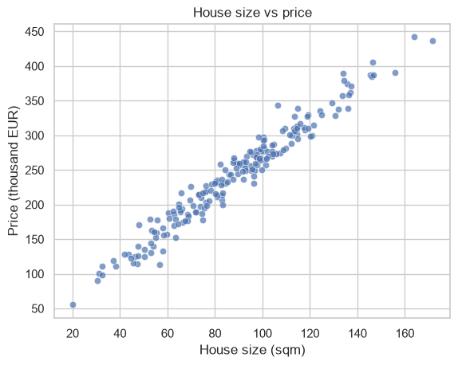

# ML Task 1 — Engineering Basics

**Subject:** Machine Learning · **Course:** 2026 HR S5 Machine Learning
**Task id:** `ml-task-1-engineering-basics`
**Status:** Done — all exercises solved, notebook executed end-to-end with outputs.

---

## 1. Task

A 3-hour self-directed seminar. It covers environment setup, NumPy/Pandas warm-up on a
synthetic dataset, the standard ML workflow (load → explore → split → train → evaluate), and
a minimal end-to-end scikit-learn pipeline on the Titanic dataset.

Deliverables:

| Part | Exercises | What was asked |
|---|---|---|
| 1 — Warm-up | 1.1 | Pandas basics on a synthetic house-size/price table: mean & median price, count > 100 sqm, `price_per_sqm`, top-5 most expensive |
| 1 — Warm-up | 1.2 | Scatter `size_sqm` vs `price_k_eur` with axis labels (seaborn suggested) |
| worked example | — | split → `LinearRegression` → R² / RMSE / coefficients |
| 2 — Titanic | 2.1 | `.info()` / `.describe()`, missing values per column, overall survival rate |
| 2 — Titanic | 2.2 | Impute `Age` (median), `Embarked` (mode), drop `Cabin`, one-hot `Sex` + `Embarked` |
| 2 — Titanic | 2.3 | Feature selection, 80/20 split, `LogisticRegression`, accuracy vs majority-class baseline |
| Wrap-up | — | 3 conceptual questions (split-first, leakage in imputation, next steps on Titanic) |

---

## 2. Repository layout

```
ml-task-1-engineering-basics/
├── notebook/
│   ├── task-1-engineering-basics.ipynb   # solved + executed notebook (main deliverable)
│   └── original_task.ipynb               # the blank seminar notebook as provided
├── data/
│   └── train.csv                         # Titanic train set (891 rows)
├── figures/
│   └── 01_size_vs_price.png              # Exercise 1.2 plot exported from the notebook
├── scripts/
│   └── fill_notebook.py                  # fills the blank notebook with the solutions
└── requirements.txt
```

---

## 3. How to run

```bash
python3 -m venv .venv && source .venv/bin/activate
pip install -r requirements.txt
jupyter notebook notebook/task-1-engineering-basics.ipynb
```

The notebook reads `../data/train.csv`, so it works both from `notebook/` and after `Run All`.
To reproduce the solved notebook from the blank one:

```bash
python scripts/fill_notebook.py notebook/task-1-engineering-basics.ipynb
jupyter nbconvert --to notebook --execute --inplace notebook/task-1-engineering-basics.ipynb
```

**Environment used:** Python 3.14, NumPy 2.x, Pandas 3.0, scikit-learn 1.9, seaborn 0.13.

> Note: the seminar's worked example uses `mean_squared_error(..., squared=False)`, which was
> removed in scikit-learn 1.6. It is replaced by `np.sqrt(mean_squared_error(...))`.

---

## 4. Results

### Exercise 1.1 — Pandas basics

| Question | Answer |
|---|---|
| Mean price | 243.34 (k€) |
| Median price | 250.27 (k€) |
| Houses larger than 100 sqm | 65 of 200 |
| `price_per_sqm` | added as a new column |
| Top-5 most expensive | the 5 rows sorted by `price_k_eur` descending (up to 441.9 k€) |

### Exercise 1.2 — Plot



Clear linear trend: the synthetic data was generated as `price = 2.5 * size + 20 + noise`.

### Worked example — linear regression

| Metric | Value |
|---|---|
| R² (test) | 0.940 |
| RMSE (test) | 16.60 k€ |
| Learned coefficient | 2.56 |
| Intercept | 15.70 |

The recovered slope (2.56) is close to the true generator (2.5), so the pipeline behaves as expected.

### Exercise 2.1 — First look at Titanic

* 891 rows, 12 columns.
* Missing values: `Age` 177, `Cabin` 687, `Embarked` 2.
* Overall survival rate: **38.4 %**.

### Exercise 2.2 — Cleaning

* `Age` → filled with the median.
* `Embarked` → filled with the mode (`S`).
* `Cabin` → dropped (77 % missing).
* `Sex`, `Embarked` → one-hot encoded with `pd.get_dummies`.

### Exercise 2.3 — Baseline classifier

Features: `Pclass`, `Age`, `SibSp`, `Parch`, `Fare`, `Sex_male`, `Embarked_C`, `Embarked_Q`,
`Embarked_S`. Stratified 80/20 split, `random_state=42`, `LogisticRegression(max_iter=1000)`.

| Model | Test accuracy |
|---|---|
| Logistic regression | **0.8045** |
| Always predict majority class ("died") | 0.6145 |

So the model beats the naive baseline by ~19 percentage points.

Top coefficients (standardised direction, not magnitude of importance):

| Feature | Coefficient |
|---|---|
| `Sex_male` | −2.56 |
| `Pclass` | −1.09 |
| `Embarked_S` | −0.35 |
| `Embarked_Q` | +0.31 |
| `SibSp` | −0.24 |
| `Parch` | −0.07 |
| `Age` | −0.04 |
| `Embarked_C` | +0.04 |
| `Fare` | +0.002 |

Being male, travelling 3rd class, and embarking at Southampton are the strongest negative
signals for survival — consistent with the historical record.

---

## 5. Wrap-up answers

1. **Why split before fitting anything?**
   The test set must stay unseen. Every step that learns from data (imputation, scaling, feature
   selection, the model itself) has to be fitted on the training set only. Otherwise information
   from the test set leaks into training and the score becomes optimistically biased — it no
   longer estimates performance on genuinely new data.

2. **What goes wrong if `Age` is imputed with the mean of the whole dataset?**
   That is **data leakage**. Statistics computed on train + test (the mean age here, and every
   derived quantity) carry test-set information into training, and the test set becomes
   unrealistically similar to the training set. Correct approach: fit
   `SimpleImputer(strategy="median")` on `X_train` and apply it to `X_test` — ideally inside a
   `Pipeline` / `ColumnTransformer`.

3. **What to engineer / investigate next on Titanic?**
   * `Name` → title (Mr / Mrs / Miss / Master) and family name → family size / group survival.
   * `Ticket` prefix and the first letter of `Cabin` (deck) — `Cabin` was dropped, but its letter is informative.
   * Age bins (child / adult), log-transformed `Fare`, interactions with `Pclass`.
   * Move all preprocessing into a `Pipeline` + `ColumnTransformer` to kill leakage by design.
   * Evaluate with cross-validation instead of a single split; try tree models
     (RandomForest / GradientBoosting) and compare.

---

## 6. Notes and caveats

* The `price_per_sqm` column in Exercise 1.1 is computed on the noisy synthetic data, so it is
  a demo quantity, not an estimate of real price per square metre.
* Coefficients of a logistic regression on unscaled features are not directly comparable in
  magnitude — they are reported only to show direction. Scaling would make them comparable.
* `Cabin` being dropped is what the exercise asks; the deck letter is left as a follow-up idea
  (see wrap-up answer 3).
