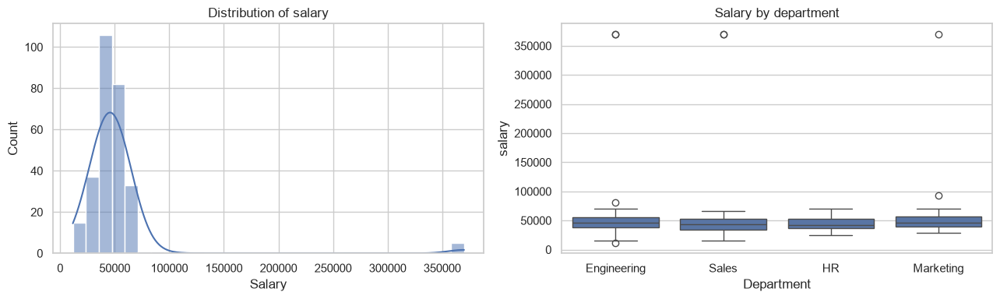
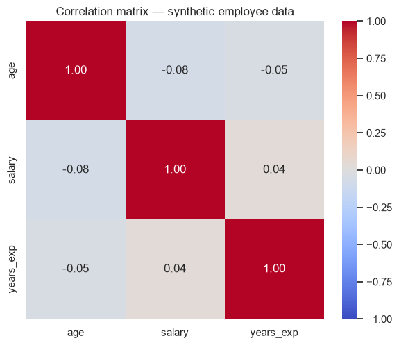
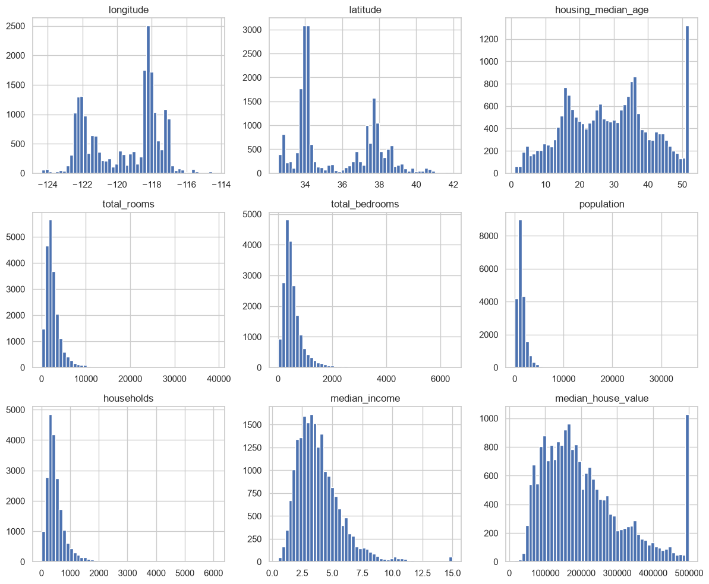
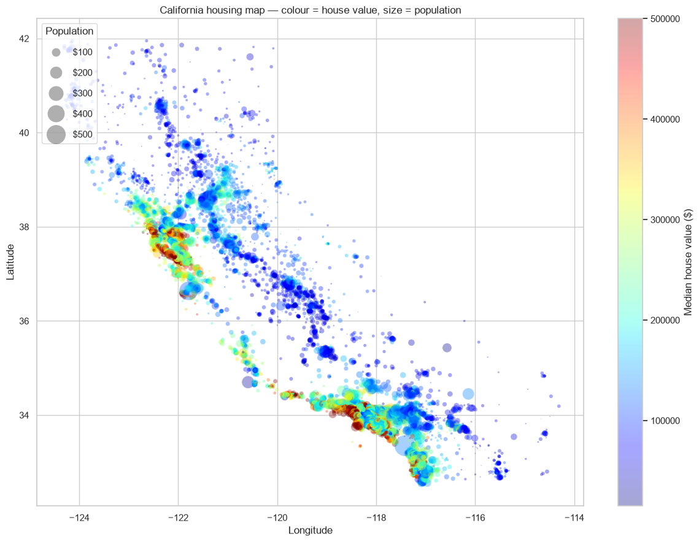
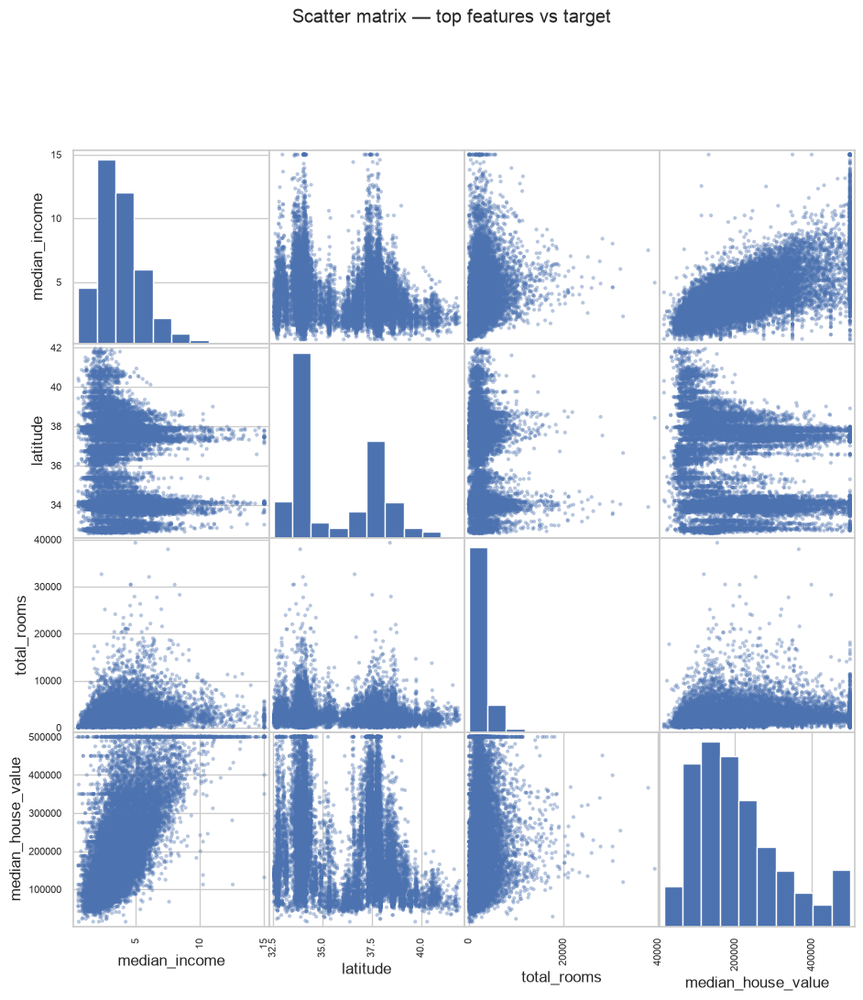

# ML Task 2 — Исследовательский (разведочный) анализ данных

Трёхчасовой самостоятельный семинар по разведочному анализу данных (EDA): проверка структуры
и качества данных, пропущенные значения, распределения, поиск выбросов методом IQR, корреляции —
сначала на синтетическом датасете с внедрёнными проблемами, затем на реальном датасете
California Housing.

> Этот файл — полный перевод ноутбука `notebook/task-2-research-data-analysis.ipynb`
> (`notebook/task-2-report.html`): весь текст, код и выводы, включая графики.

---

## Тема 2 — Исследовательский (разведочный) анализ данных
### Семинар на 3 часа

**Рекомендуемый тайминг (3 ч):**
- 0:00–0:15 — прочитать материалы и цели
- 0:15–1:15 — Часть 1: приёмы EDA на «пустом» датасете с внедрёнными проблемами
- 1:15–1:25 — перерыв
- 1:25–2:45 — Часть 2: полный EDA на реальном датасете с Kaggle (California Housing)
- 2:45–3:00 — итоговые вопросы

**Перед семинаром:** изучить лекционный материал самостоятельно — это курс «без лекций»,
поэтому указанные ниже материалы считаются обязательной подготовкой, а не опцией.

## Цели обучения
- Системно описывать структуру датасета: размерность, типы, проблемы качества
- Находить пропущенные значения и выбросы и рассуждать о них
- Использовать сводные статистики, гистограммы, boxplot'ы и корреляционные heatmap'ы для поиска закономерностей
- Формулировать по итогам EDA гипотезы, которые позже сможет проверить модель

## Обязательные материалы
- McKinney, *Python for Data Analysis* — гл. 5, 7, 8 (основы Pandas, очистка данных, преобразование данных)
- Мини-курс Kaggle «Pandas»: https://www.kaggle.com/learn/pandas
- Мини-курс Kaggle «Data Cleaning»: https://www.kaggle.com/learn/data-cleaning
- Мои ноутбуки 1 и 2 по курсу DA

## Подготовка окружения

```python
import numpy as np
import pandas as pd
import matplotlib.pyplot as plt
import seaborn as sns

np.random.seed(1)
sns.set(style="whitegrid")
```

---

## Часть 1 — EDA на «пустом» датасете с внедрёнными проблемами

Построим синтетический датасет «сотрудники» и намеренно внедрим пропущенные значения
и выбросы, чтобы потренироваться их находить.

```python
n = 300
df = pd.DataFrame({
    "age": np.random.normal(35, 8, n).round().astype(float),
    "salary": np.random.normal(45000, 12000, n).round(2),
    "years_exp": np.random.normal(8, 4, n).clip(0).round(1),
    "department": np.random.choice(["Sales", "Engineering", "Marketing", "HR"], n, p=[0.3, 0.4, 0.2, 0.1]),
})

# внедряем проблемы
df.loc[np.random.choice(n, 20, replace=False), "salary"] = np.nan
df.loc[np.random.choice(n, 10, replace=False), "age"] = np.nan
df.loc[np.random.choice(n, 5, replace=False), "salary"] = df["salary"].max() * 4  # выбросы
df.head()
```

```
    age    salary  years_exp   department
0  48.0  69789.40        3.7  Engineering
1  30.0  27346.12       10.0        Sales
2  31.0  35037.94        4.2           HR
3  26.0       NaN        5.9    Marketing
4   NaN  41650.83        2.2    Marketing
```

### Упражнение 1.1 — Структурный обзор
1. Вывести shape, dtypes и `.isna().sum()`
2. Какой % строк имеет хотя бы один пропуск?

```python
# 1. shape, dtypes, количество пропусков
print("Shape:", df.shape)
print()
print(df.dtypes)
print()
print("Пропуски по колонкам:")
print(df.isna().sum())

# 2. доля строк хотя бы с одним пропуском
rows_with_na = df.isna().any(axis=1).sum()
print()
print(f"Строк хотя бы с одним пропуском: {rows_with_na} / {len(df)}"
      f" ({rows_with_na / len(df):.1%})")
```

```
Shape: (300, 4)

age           float64
salary        float64
years_exp     float64
department        str
dtype: object

Пропуски по колонкам:
age           10
salary        20
years_exp      0
department     0
dtype: int64

Строк хотя бы с одним пропуском: 29 / 300 (9.7%)
```

### Упражнение 1.2 — Распределения
1. Построить гистограмму `salary`
2. Построить boxplot `salary` по `department`
3. Видно ли что-то подозрительное? Объяснить в markdown-ячейке.

```python
# 1. гистограмма salary
fig, axes = plt.subplots(1, 2, figsize=(13, 4))

sns.histplot(df["salary"].dropna(), bins=30, kde=True, ax=axes[0])
axes[0].set_title("Распределение зарплаты")
axes[0].set_xlabel("Зарплата")

# 2. boxplot salary по department
sns.boxplot(data=df, x="department", y="salary", ax=axes[1])
axes[1].set_title("Зарплата по отделам")
axes[1].set_xlabel("Отдел")

plt.tight_layout()
plt.show()
```



**Наблюдения.**

* Гистограмму зарплаты перевешивают несколько экстремальных значений справа: несколько точек
  лежат примерно на 4× от нормального максимума зарплаты (~200k+, тогда как основная масса
  распределения — между 20k и 70k). Из-за них кривая KDE почти плоская, а «настоящее»
  распределение сжато к левому краю графика.
* Boxplot делает проблему очевидной: в каждом отделе нормально выглядящий ящик около 45k плюс
  длинный хвост выбросов выше верхнего уса — и в каждом отделе есть по одной точке примерно
  на 200k. Это внедрённые значения `salary.max() * 4`, а не реальный эффект уровня отдела.
* Медианы по отделам почти одинаковы, что ожидаемо: в синтетических данных зарплата
  генерировалась независимо от отдела.

### Упражнение 1.3 — Поиск выбросов методом IQR
Написать функцию `flag_outliers_iqr(series)`, возвращающую булеву маску значений вне
`[Q1 - 1.5*IQR, Q3 + 1.5*IQR]`. Применить её к `salary` и посчитать найденные выбросы.

```python
def flag_outliers_iqr(series):
    """Булева маска значений вне [Q1 - 1.5*IQR, Q3 + 1.5*IQR]."""
    q1, q3 = series.quantile([0.25, 0.75])
    iqr = q3 - q1
    lower, upper = q1 - 1.5 * iqr, q3 + 1.5 * iqr
    return (series < lower) | (series > upper)


outlier_mask = flag_outliers_iqr(df["salary"])
print("Найдено выбросов (пропуски в зарплате исключены):", outlier_mask.sum())
print()
print("Границы для salary:",
      round(df["salary"].quantile(0.25) - 1.5 * (df["salary"].quantile(0.75) - df["salary"].quantile(0.25)), 2),
      "…",
      round(df["salary"].quantile(0.75) + 1.5 * (df["salary"].quantile(0.75) - df["salary"].quantile(0.25)), 2))
print()
print(df.loc[outlier_mask, ["salary", "department"]].sort_values("salary"))

# та же проверка для любой другой колонки:
for col in ["age", "salary", "years_exp"]:
    print(f"{col:>10}: {flag_outliers_iqr(df[col]).sum()} выбросов")
```

```
Найдено выбросов (пропуски в зарплате исключены): 8

Границы для salary: 11845.38 … 80802.94

        salary   department
67    11609.59  Engineering
14    81370.29  Engineering
265   92503.23    Marketing
11   370012.92    Marketing
112  370012.92  Engineering
174  370012.92  Engineering
228  370012.92        Sales
286  370012.92        Sales
       age: 5 выбросов
    salary: 8 выбросов
 years_exp: 1 выбросов
```

### Упражнение 1.4 — Корреляция
Посчитать матрицу корреляций числовых колонок и визуализировать её через `sns.heatmap`.
Какая пара переменных коррелирована сильнее всего и логично ли это?

```python
numeric = df.select_dtypes(include="number")
corr = numeric.corr()

plt.figure(figsize=(6, 5))
sns.heatmap(corr, annot=True, fmt=".2f", cmap="coolwarm", vmin=-1, vmax=1, square=True)
plt.title("Матрица корреляций — синтетические данные о сотрудниках")
plt.tight_layout()
plt.show()

corr
```



```
                age    salary  years_exp
age        1.000000 -0.076045  -0.045120
salary    -0.076045  1.000000   0.035383
years_exp -0.045120  0.035383   1.000000
```

Осмысленной корреляции нет: самые сильные связи — `age`/`salary` (−0,08) и
`age`/`years_exp` (−0,05), то есть практически ноль. Это логично: синтетические
колонки генерировались независимо друг от друга.

---

## Часть 2 — Реальные данные: California Housing Prices (Kaggle)

**Где взять данные:** https://www.kaggle.com/datasets/camnugent/california-housing-prices
Скачать `housing.csv` и положить рядом с ноутбуком (в репозитории он уже лежит в `data/`).

```python
DATA_PATH = "../data/housing.csv"  # California housing, лежит в data/
housing = pd.read_csv(DATA_PATH)
housing.head()
```

```
   longitude  latitude  housing_median_age  total_rooms  total_bedrooms  \
0    -122.23     37.88                41.0        880.0           129.0   
1    -122.22     37.86                21.0       7099.0          1106.0   
2    -122.24     37.85                52.0       1467.0           190.0   
3    -122.25     37.85                52.0       1274.0           235.0   
4    -122.25     37.85                52.0       1627.0           280.0   

   population  households  median_income  median_house_value ocean_proximity  
0       322.0       126.0         8.3252            452600.0        NEAR BAY  
1      2401.0      1138.0         8.3014            358500.0        NEAR BAY  
2       496.0       177.0         7.2574            352100.0        NEAR BAY  
3       558.0       219.0         5.6431            341300.0        NEAR BAY  
4       565.0       259.0         3.8462            342200.0        NEAR BAY  
```

### Упражнение 2.1 — Первый проход
1. `.info()`, `.describe()` и пропуски по колонкам
2. Счётчики значений для категориальной колонки `ocean_proximity`

```python
# 1. info / describe / пропуски
housing.info()
print()
print(housing.describe().T)
print()
print("Пропуски по колонкам:")
print(housing.isna().sum())

# 2. счётчики ocean_proximity
print()
print(housing["ocean_proximity"].value_counts())
```

```
<class 'pandas.DataFrame'>
RangeIndex: 20640 entries, 0 to 20639
Data columns (total 10 columns):
 #   Column              Non-Null Count  Dtype  
---  ------              --------------  -----  
 0   longitude           20640 non-null  float64
 1   latitude            20640 non-null  float64
 2   housing_median_age  20640 non-null  float64
 3   total_rooms         20640 non-null  float64
 4   total_bedrooms      20433 non-null  float64
 5   population          20640 non-null  float64
 6   households          20640 non-null  float64
 7   median_income       20640 non-null  float64
 8   median_house_value  20640 non-null  float64
 9   ocean_proximity     20640 non-null  str    
dtypes: float64(9), str(1)
memory usage: 1.6 MB

                      count           mean            std         min  \
longitude           20640.0    -119.569704       2.003532   -124.3500   
latitude            20640.0      35.631861       2.135952     32.5400   
housing_median_age  20640.0      28.639486      12.585558      1.0000   
total_rooms         20640.0    2635.763081    2181.615252      2.0000   
total_bedrooms      20433.0     537.870553     421.385070      1.0000   
population          20640.0    1425.476744    1132.462122      3.0000   
households          20640.0     499.539680     382.329753      1.0000   
median_income       20640.0       3.870671       1.899822      0.4999   
median_house_value  20640.0  206855.816909  115395.615874  14999.0000   

                            25%          50%           75%          max  
longitude             -121.8000    -118.4900    -118.01000    -114.3100  
latitude                33.9300      34.2600      37.71000      41.9500  
housing_median_age      18.0000      29.0000      37.00000      52.0000  
total_rooms           1447.7500    2127.0000    3148.00000   39320.0000  
total_bedrooms         296.0000     435.0000     647.00000    6445.0000  
population             787.0000    1166.0000    1725.00000   35682.0000  
households             280.0000     409.0000     605.00000    6082.0000  
median_income            2.5634       3.5348       4.74325      15.0001  
median_house_value  119600.0000  179700.0000  264725.00000  500001.0000  

Пропуски по колонкам:
longitude               0
latitude                0
housing_median_age      0
total_rooms             0
total_bedrooms        207
population              0
households              0
median_income           0
median_house_value      0
ocean_proximity         0
dtype: int64

ocean_proximity
<1H OCEAN     9136
INLAND        6551
NEAR OCEAN    2658
NEAR BAY      2290
ISLAND           5
Name: count, dtype: int64
```

Итого: 20 640 строк × 10 колонок; `ocean_proximity` — единственная строковая колонка;
пропуски только в `total_bedrooms` (207, ≈1 %).

### Упражнение 2.2 — Распределения и асимметрия
1. Гистограммы всех числовых колонок (`df.hist(bins=50, figsize=(12,10))`)
2. Какие переменные выглядят асимметричными? Помог бы кому-то логарифм?

```python
housing.hist(bins=50, figsize=(12, 10))
plt.tight_layout()
plt.show()
```



**Наблюдения по асимметрии.**

* `median_house_value` **ограничена сверху** на 500001 — всплеск на правом краю. Этот потолок
  цен — артефакт данных, а не реальное распределение; его надо убирать или обрабатывать явно
  (строки выше потолка удалить либо обрезать), иначе модель не сможет выучить настоящую
  зависимость для дорогих районов.
* `median_income` скошена вправо, но учтите: она уже ограничена примерно на 15 (15k$/месяц)
  и выражена в десятках тысяч — основная масса между 1 и 6.
* `population`, `total_rooms`, `total_bedrooms`, `households` — все сильно скошены вправо
  с длинным хвостом: несколько районов с десятками тысяч человек рядом с типичными несколькими
  тысячами. **Логарифмирование** (`np.log1p`) сделало бы их гораздо ближе к нормальному —
  это полезно для моделей, основанных на расстояниях, и для любых моделей, предполагающих
  примерно симметричные ошибки.
* `housing_median_age` примерно равномерна со всплеском на своём потолке в 52 года.
* `latitude` и `longitude` не скошены (двухмодальные / географические, преобразование
  не нужно) — логарифмировать их нельзя.

Итог: логарифмировать счётные признаки; **не** логарифмировать возраст, широту/долготу
и саму целевую переменную, не проверив сначала потолок.

### Упражнение 2.3 — География
Построить географический scatter: `longitude` по X, `latitude` по Y, цвет = `median_house_value`,
размер = `population`.

```python
plt.figure(figsize=(12, 9))
sc = plt.scatter(
    housing["longitude"], housing["latitude"],
    c=housing["median_house_value"], cmap="jet",
    s=housing["population"] / 60, alpha=0.35, linewidths=0,
)
plt.colorbar(sc, label="Медианная стоимость жилья ($)")
plt.xlabel("Долгота")
plt.ylabel("Широта")
plt.title("Карта жилья Калифорнии — цвет = стоимость, размер = население")
plt.legend(*sc.legend_elements("sizes", num=4, fmt="${x:.0f}"), title="Население",
           loc="upper left", labelspacing=1.2)
plt.tight_layout()
plt.show()
```



Классическая карта Калифорнии: плотные скопления Лос-Анджелеса и Bay Area, внутренние районы
дешевле и дальше от побережья. Цвет = стоимость жилья, размер = население.

### Упражнение 2.4 — Корреляция с целевой переменной
Посчитать корреляцию каждого числового признака с целевой переменной, взять топ-3 признака
по модулю корреляции и построить матрицу scatter.

```python
# 1. корреляция каждого числового признака с целью
corr_target = (housing.select_dtypes(include="number")
               .corr()["median_house_value"]
               .drop("median_house_value")
               .sort_values(ascending=False))
print(corr_target)

# 2. топ-3 признака по модулю корреляции
top_features = corr_target.abs().sort_values(ascending=False).head(3).index.tolist()
print()
print("Топ-3:", top_features)

# 3. матрица scatter для топ-признаков + цели
pd.plotting.scatter_matrix(housing[top_features + ["median_house_value"]],
                           figsize=(11, 11), alpha=0.4, diagonal="hist")
plt.suptitle("Матрица scatter — топ-признаки против цели", y=1.02)
plt.show()
```

```
median_income         0.688075
total_rooms           0.134153
housing_median_age    0.105623
households            0.065843
total_bedrooms        0.049686
population           -0.024650
longitude            -0.045967
latitude             -0.144160
Name: median_house_value, dtype: float64

Топ-3: ['median_income', 'latitude', 'total_rooms']
```



| Признак | corr с `median_house_value` |
|---|---|
| `median_income` | **0,688** |
| `latitude` | −0,144 |
| `total_rooms` | 0,134 |
| `housing_median_age` | 0,106 |
| `households` | 0,066 |
| `total_bedrooms` | 0,050 |
| `longitude` | −0,046 |
| `population` | −0,025 |

`median_income` резко выделяется; у `latitude` связь отрицательная (севернее — дешевле).
Матрица scatter показывает явный восходящий тренд у `median_income`, тогда как `total_rooms`
даёт слабую веерообразную связь (это размер района, а не дома) — намёк на необходимость
признака-отношения.

---

## Итоговые вопросы
1. Назовите три проблемы качества данных, которые вы бы исправили перед моделированием этого датасета.
2. Почему хорошая практика — делать EDA только на **обучающей выборке** (а не на всём датасете)?
3. Предложите один новый признак, который можно сконструировать из существующих колонок
   (например, число комнат на домохозяйство), и объясните, почему он может помочь модели.

## Ответы на итоговые вопросы

**1. Три проблемы качества данных перед моделированием**

1. **Пропуски в `total_bedrooms`** (207 строк). Заполнить — например, медианой *внутри того же
   `ocean_proximity`* или медианой отношения к `total_rooms` — либо удалить эти строки; в любом
   случае импутер должен обучаться только на train.
2. **Потолок целевой переменной на `median_house_value == 500001`** (а также потолки
   `median_income` / `housing_median_age`). Эти строки — цензурированные данные: модель выучивает
   плоскую «потолочную» область, которой в реальности не существует. Либо удалить такие районы,
   либо моделировать значение как цензурированное / явно обрезать и задокументировать решение.
3. **Сильная правосторонняя асимметрия и совершенно разные масштабы** у `total_rooms`,
   `total_bedrooms`, `population`, `households`, `median_income`. Лечится логарифмированием и/или
   `StandardScaler` — снова обученными только на train.
   (Дополнительно: `ocean_proximity` — строка, её надо закодировать; и нет признака
   «домохозяйства», согласованного по единицам, поэтому число комнат несравнимо между районами
   разного размера.)

**2. Почему EDA только на обучающей выборке?**

EDA сам по себе — шаг моделирования: каждое решение, которое он подсказывает (какие выбросы
обрезать, какая стратегия импутации, какие преобразования, какие признаки оставить, каким
корреляциям доверять), — это параметр, выученный из данных. Если смотреть на весь датасет,
включая тест, то решения принимаются с учётом тестовых данных. Это утечка данных (data leakage):
тест перестаёт имитировать действительно невиданные данные, метрика становится оптимистично
смещённой, и оценке на hold-out больше нельзя доверять. Практический рецепт: сначала разделить,
всю статистику и графики делать на `train`, а `test` только преобразовывать статистиками,
выученными на train.

**3. Признак, который стоит сконструировать: комнаты на домохозяйство**

```python
housing["rooms_per_household"] = housing["total_rooms"] / housing["households"]
```

Почему это может помочь: сырой `total_rooms` измеряет **размер района**, а не размер дома —
большой район тривиально имеет много комнат, что заглушает информацию о жилой площади.
Деление на `households` нормирует его в «комнаты на жильё», что близко к тому, что реально
определяет цену дома. Обычно такой признак коррелирует с ценой сильнее, чем `total_rooms`,
и убирает большую часть конфаундинга по размеру населения.

Дальше — стандартные признаки-отношения:

```python
housing["bedrooms_ratio"] = housing["total_bedrooms"] / housing["total_rooms"]
housing["population_per_household"] = housing["population"] / housing["households"]
```

Дома с низкой долей спален обычно крупнее и роскошнее в пересчёте на комнату, а
`population_per_household` отражает скученность — оба признака, как известно, улучшают
модели по California Housing.

---

## Структура репозитория и запуск

```
ml-task-2-research-data-analysis/
├── README.md                                 # этот файл (перевод ноутбука)
├── README.ru.md                              # краткий обзор задания и результатов
├── notebook/
│   ├── task-2-research-data-analysis.ipynb   # решённый + выполненный ноутбук
│   ├── task-2-report.html                    # он же как HTML-отчёт
│   └── original_task.ipynb                   # пустой семинарский ноутбук в исходном виде
├── data/
│   └── housing.csv                           # California Housing (20 640 строк, Kaggle)
├── figures/                                  # графики из ноутбука (для README)
├── scripts/
│   └── fill_notebook.py                      # заполняет пустой ноутбук решениями
└── requirements.txt
```

```bash
python3 -m venv .venv && source .venv/bin/activate
pip install -r requirements.txt jupyterlab
cd notebook && jupyter lab     # открыть ноутбук → Run All
```

Ноутбук читает `../data/housing.csv`, поэтому из папки `notebook/` он работает после «Run All».
Воспроизвести решённый ноутбук из пустого:

```bash
python scripts/fill_notebook.py notebook/task-2-research-data-analysis.ipynb
jupyter nbconvert --to notebook --execute --inplace notebook/task-2-research-data-analysis.ipynb
```

**Использованное окружение:** Python 3.14, NumPy 2.5, Pandas 3.0, Matplotlib 3.11, seaborn 0.13.
