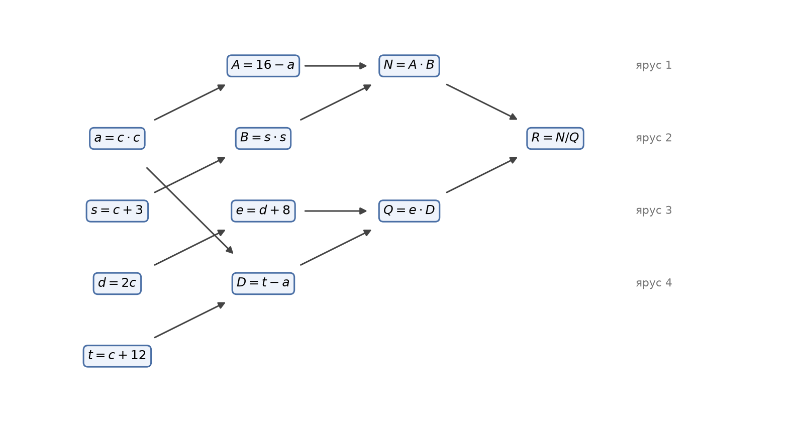
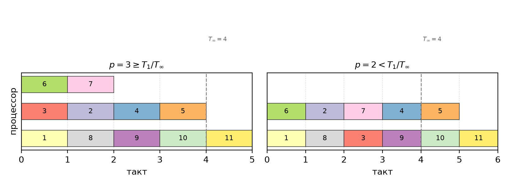

# Multithread Java — Практическое занятие 1

**Тема:** Анализ трудоёмкости параллельных вычислений

## Цель работы

Освоить базовый анализ трудоёмкости параллельных вычислений на простых арифметических
примерах: построить информационный граф «операции–операнды», найти последовательное время
$T_1$, минимальное время $T_\infty$, число процессоров, ускорение, эффективность и стоимость,
а также выбрать оптимальное число процессоров по теореме 5.

**Моё задание (№3 в списке):**

$$\frac{(16-c^2)(c^2+6c+9)}{(2c+8)(12+c-c^2)}$$

## 1. Подготовка выражения

Раскладываю на множители числитель и знаменатель:

- $16-c^2=(4-c)(4+c)$;
- $c^2+6c+9=(c+3)^2$;
- $2c+8=2(c+4)$;
- $12+c-c^2=-(c^2-c-12)=-(c-4)(c+3)$.

Подставляю:

$$\frac{(4-c)(4+c)(c+3)^2}{2(c+4)\cdot(-(c-4)(c+3))}=
\frac{-(c-4)(c+4)(c+3)^2}{-2(c+4)(c-4)(c+3)}=\frac{c+3}{2}$$

После сокращения остаётся одно сложение и одно деление. Чтобы расчёт был содержательным,
считаю исходное выражение целиком (упрощение — только для проверки результата).

## 2. Информационный граф «операции–операнды»

Принимаю модель из лекции: все операции стоят 1, передача данных мгновенная.
Входное данное одно — $c$, все остальные числа константы.



Операции (в скобках — операнды):

| № | Операция | Зависит от |
|---|---|---|
| 1 | $a=c\cdot c$ | $c$ |
| 2 | $A=16-a$ | 1 |
| 3 | $s=c+3$ | $c$ |
| 4 | $B=s\cdot s$ | 3 |
| 5 | $N=A\cdot B$ | 2, 4 |
| 6 | $d=2c$ | $c$ |
| 7 | $e=d+8$ | 6 |
| 8 | $t=c+12$ | $c$ |
| 9 | $D=t-a$ | 8, 1 |
| 10 | $Q=e\cdot D$ | 7, 9 |
| 11 | $R=N/Q$ | 5, 10 |

Итого $T_1=|V|=11$ операций.

## 3. Ярусно-параллельная форма и $T_\infty$

| Ярус | Операции | Кол-во |
|---|---|---|
| 1 | 1, 3, 6, 8 | 4 |
| 2 | 2, 4, 7, 9 | 4 |
| 3 | 5, 10 | 2 |
| 4 | 11 | 1 |

Диаметр графа $d(G)=4$ (критический путь $c\to s\to B\to N\to R$ и $c\to d\to e\to Q\to R$),
значит по теореме 1:

$$T_\infty=d(G)=4$$

Проверка по теореме 2: $T_\infty\ge\log_2 11\approx 3{,}46$, то есть $4$ — достижимый минимум.

## 4. Расчёт на наличном числе процессоров

Беру $p=6$ (ровно столько, сколько заданий есть в самом широком ярусе), а затем
$p=2$ и $p=4$ для сравнения.

| $p$ | Расписание | $T_p$ | $S_p=T_1/T_p$ | $E_p=S_p/p$ | $C_p=p\,T_p$ |
|---|---|---|---|---|---|
| 1 | последовательно | 11 | 1,00 | 1,00 | 11 |
| 2 | 1–6 → 2–7 → 8,3 → 9,4 → 10,5 → 11 | 6 | 1,83 | 0,92 | 12 |
| 4 | 1–4 → 5–8 → 9,10 → 11 | 4 | 2,75 | 0,69 | 16 |
| 6 | ярусы по таблице п.3 | 4 | 2,75 | 0,46 | 24 |

На $p=4$ расписание: ярус 1 — операции 1,3,6,8; ярус 2 — 2,4,7,9; ярус 3 — 5,10; ярус 4 — 11.

Проверка по теореме 3: $T_p<T_\infty+T_1/p$ даёт для $p=2$ оценку $7{,}5$ (у нас 6),
для $p=6$ — $5{,}83$ (у нас 4). Оценки выполняются.

## 5. Теорема 5: оптимальное число процессоров

$$p\approx\frac{T_1}{T_\infty}=\frac{11}{4}=2{,}75\ \Rightarrow\ p_{\text{opt}}=3$$

При $p\ge T_1/T_\infty$ гарантировано $T_p\le 2T_\infty$, при $p<T_1/T_\infty$ имеем
$T_1/p\le T_p\le 2T_1/p$. Смысл: процессоров больше трёх смысла не имеют — время всё
равно упирается в критический путь, а стоимость растёт линейно.

## 6. Схемы для $p\ge T_1/T_\infty$ и $p<T_1/T_\infty$

Последовательность выполнения по тактам показана на диаграмме Ганта
(слева $p=3$, справа $p=2$, пунктир — $T_\infty=4$):



| Case | $p$ | $T_p$ | $T_1/p$ | $S_p$ | $E_p$ | $C_p$ |
|---|---|---|---|---|---|---|
| $p<T_1/T_\infty$ | 2 | 6 | 5,5 | 1,83 | 0,92 | 12 |
| $p<T_1/T_\infty$ | 3 | 5 | 3,67 | 2,20 | 0,73 | 15 |
| $p\ge T_1/T_\infty$ | 4 | 4 | 2,75 | 2,75 | 0,69 | 16 |
| $p\ge T_1/T_\infty$ | 6 | 4 | 1,83 | 2,75 | 0,46 | 24 |

Расписание для $p=3$: такт 1 — 1,3,6; такт 2 — 8,2,7; такт 3 — 9,4; такт 4 — 10,5;
такт 5 — 11.

Начиная с $p=3$ время держится на уровне $T_\infty=4$–$5$: рост процессоров больше не
даёт ускорения, только снижает эффективность и увеличивает стоимость. Поэтому $p=3$
($C_p=15$ против $C_1=11$) — самая выгодная точка; $p=1$ — последовательный вариант,
где $S_p=1$.

## 7. Выводы

- Граф содержит 11 операций, критический путь 4 операции, поэтому $T_1=11$, $T_\infty=4$,
  теоретически возможное ускорение не больше $T_1/T_\infty=2{,}75$.
- При $p=4$ оно уже достигается ($S_p=2{,}75$, $E_p\approx0{,}69$), дальнейшее наращивание
  процессоров не помогает.
- В маленьких задачах параллелизм сильно ограничен «высотой» графа: больше процессоров,
  чем $T_1/T_\infty$, бесполезны и просто увеличивают стоимость $C_p=pT_p$.
- Для задачи характерны ограниченный параллелизм ($E_p$ падает с 0,92 до 0,46) и
  отсутствие масштабирования при фиксированном объёме вычислений.

## 8. Код

Файлы в этой папке:

- `MTJavaTask1.java` — строит информационный граф, печатает ярусно-параллельную
  форму, считает $S_p$, $E_p$, $C_p$ для $p=1..6$, находит $p_{\text{opt}}$ и проверяет
  вычисления по формуле $(c+3)/2$;
- `input.txt` — значения $c$ для проверки (можно менять).

```bash
javac MTJavaTask1.java
java MTJavaTask1              # значения по умолчанию: 2, 5, -3, 0.5
java MTJavaTask1 input.txt    # свои значения из файла
```

Пример вывода (проверка вычислений):

```
       c    полный расчёт  формула (c+3)/2      разница
   2.000         2.500000         2.500000     0.00e+00
   5.000         4.000000         4.000000     0.00e+00
  -3.000     не определён         0.000000            —
   0.500         1.750000         1.750000     0.00e+00
```

При $c=-3$ исходное выражение даёт $0/0$ (не определено), а после сокращения
получается 0 — это устранимый разрыв, а не ошибка расчёта.
