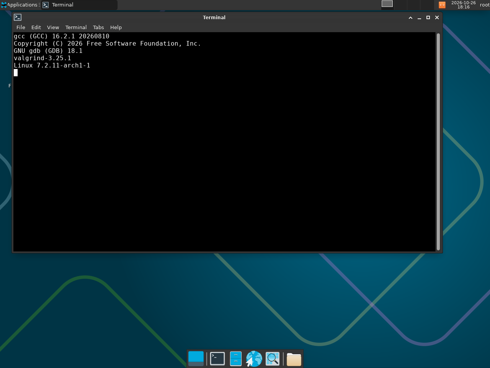
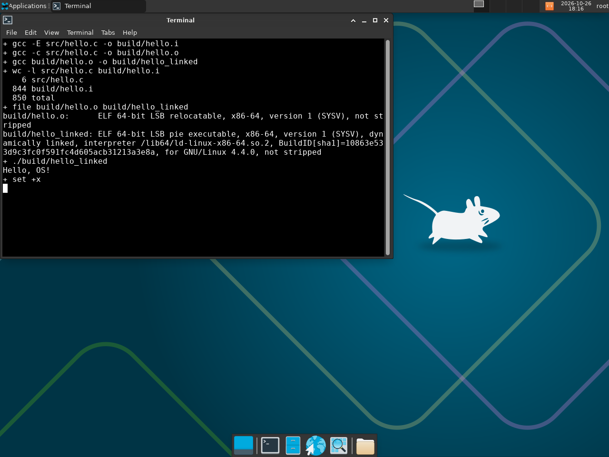
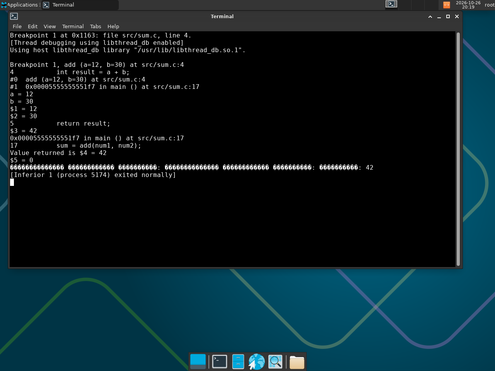
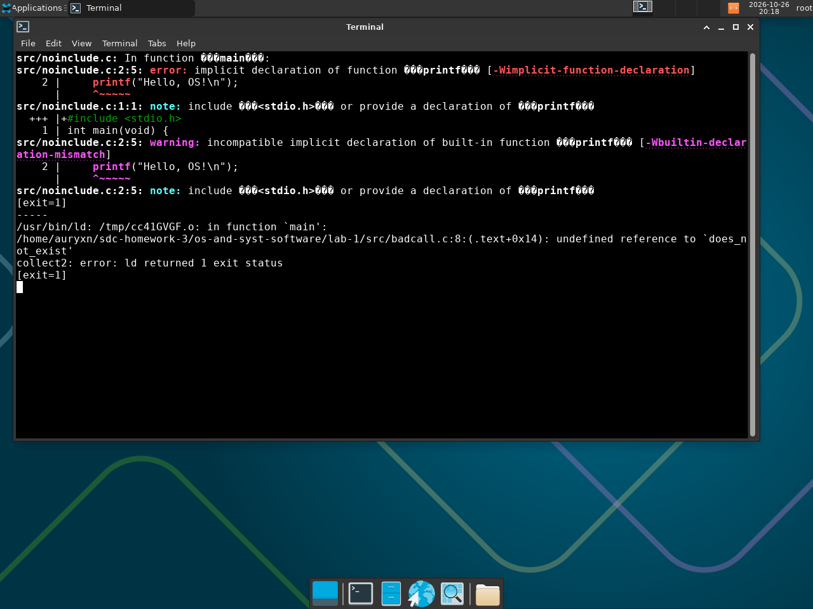
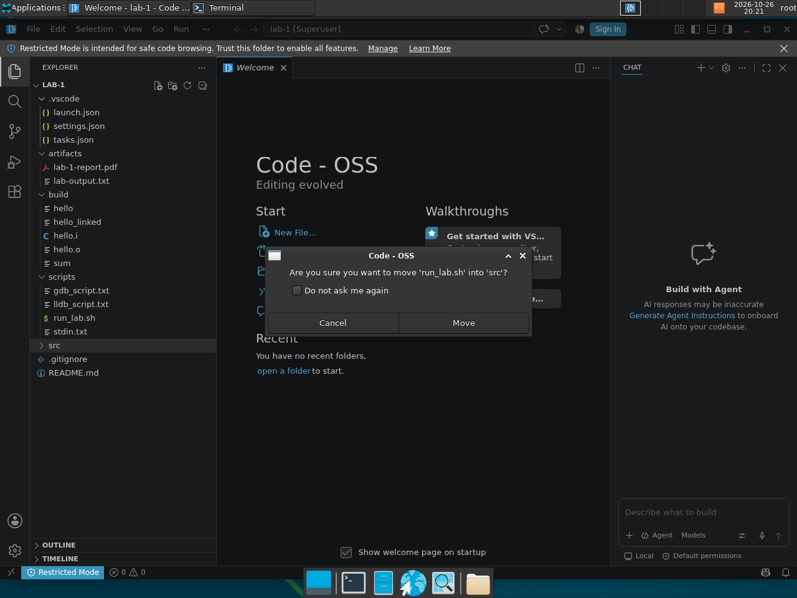

# Лабораторная работа №1 — Знакомство со средствами разработки программ на языке C

**Предмет:** OS And Syst Software
**Курс:** 2026 HR S5 OS And Syst Software
**Выполнил:** Aliaksei Ioda
**Дата:** 26.10.2026

## Цель работы

Подготовить рабочее окружение для разработки на C в Linux, разобраться, из каких
этапов состоит создание программы, и научиться собирать, запускать и отлаживать
программу как из IDE, так и из командной строки.

## Окружение

Работа выполнена в **GNU/Linux** — установленный Arch Linux в виртуальной машине
VirtualBox на ноутбуке (Intel Core i7, 16 ГБ ОЗУ). Это полноценная установка
дистрибутива, а не live-образ и не WSL: загрузчик GRUB, своя ФС, ядро Arch.

| Компонент | Версия / значение |
|---|---|
| ОС | Arch Linux (rolling), ядро 7.2.11-arch1-1, x86_64 |
| Виртуализация | VirtualBox 7.2.22, ВМ: 4 ГБ ОЗУ, 2 vCPU, диск 25 ГБ |
| Компилятор | gcc (GCC) 16.2.1 20260810 |
| Отладчик | GNU gdb (GDB) 18.1 |
| Проверка памяти | valgrind-3.25.1 |
| Сборка | GNU Make 4.4.1 |
| IDE | Visual Studio Code (Code - OSS) 1.138.0 |
| Раскладка/локаль | en_US.UTF-8, часовой пояс Europe/Vilnius |

Установка инструментов в Arch:

```bash
sudo pacman -S --needed base-devel gcc gdb valgrind make git code
```

Проверка версий:



```console
$ gcc --version
gcc (GCC) 16.2.1 20260810
Copyright (C) 2026 Free Software Foundation, Inc.

$ gdb --version
GNU gdb (GDB) 18.1
Copyright (C) 2026 Free Software Foundation, Inc.
License GPLv3+: GNU GPL version 3 or later <http://gnu.org/licenses/gpl.html>

$ valgrind --version
valgrind-3.25.1

$ uname -sr
Linux 7.2.11-arch1-1
```

## Структура работы

```
lab-1/
├── README.md                     — этот отчёт
├── src/
│   ├── hello.c                   — минимальная программа
│   ├── sum.c                     — сумма двух чисел (с функцией add)
│   ├── noinclude.c               — ошибка: нет #include <stdio.h>
│   └── badcall.c                 — ошибка: вызов функции без определения
├── scripts/
│   ├── run_lab.sh                — воспроизводимый прогон всех этапов
│   ├── gdb_script.txt            — команды для gdb
│   └── stdin.txt                 — входные данные 12 и 30
├── .vscode/
│   ├── tasks.json                — сборка hello и sum (VS Code → Run Build Task)
│   └── launch.json               — отладка sum под gdb (F5)
└── artifacts/
    ├── lab-output.txt            — полный лог выполнения
    └── screenshots/              — скриншоты этапов (Linux)
```

Полный лог: [`artifacts/lab-output.txt`](artifacts/lab-output.txt).

---

## 1. Сборка и запуск hello.c из командной строки

```c
#include <stdio.h>

int main(void) {
    printf("Hello, OS!\n");
    return 0;
}
```

```console
$ gcc -g -O0 src/hello.c -o build/hello
$ ./build/hello
Hello, OS!
$ echo $?
0
```

`-g` добавляет отладочную информацию (имена переменных, номера строк — без неё
gdb не покажет исходник), `-O0` отключает оптимизации, чтобы выполняемый код
соответствовал строкам программы. Код возврата `0` — признак успешного
завершения: именно его проверяют скрипты и системы сборки.

## 2. Программа «сумма двух чисел»

```c
#include <stdio.h>

int add(int a, int b) {
    int result = a + b;
    return result;
}

int main(void) {
    int num1, num2, sum;

    printf("Введите первое число: ");
    scanf("%d", &num1);

    printf("Введите второе число: ");
    scanf("%d", &num2);

    sum = add(num1, num2);
    printf("Сумма: %d\n", sum);
    return 0;
}
```

```console
$ gcc -g -O0 src/sum.c -o build/sum
$ printf '12\n30\n' | ./build/sum
Введите первое число: Введите второе число: Сумма: 42
```

Отдельная функция `add` нужна, чтобы на этапе отладки было куда «заходить»
командой Step Into: у неё есть свой стековый фрейм и свои аргументы.

## 3. Стадии сборки: препроцессор, компиляция, компоновка

```console
$ gcc -E src/hello.c -o build/hello.i     # только препроцессор
$ gcc -c src/hello.c -o build/hello.o     # компиляция в объектный файл
$ gcc build/hello.o -o build/hello_linked # компоновка
$ ./build/hello_linked
Hello, OS!
```



**Почему `hello.i` в 140 раз больше исходника.** `wc -l` даёт 6 строк в
`hello.c` против 844 строк в `hello.i`: препроцессор физически подставляет в
текст всё содержимое `#include <stdio.h>` (объявления `printf`, типы, макросы),
поэтому файл раздувается до тысяч строк. Компилятор при этом не «смотрит» на
объявления из других модулей — они нужны ему как текст, который и приносит
препроцессор.

**Разница между объектным и исполняемым файлом** (`file`):

```console
build/hello.o:      ELF 64-bit LSB relocatable, x86-64, version 1 (SYSV), not stripped
build/hello_linked: ELF 64-bit LSB pie executable, x86-64, version 1 (SYSV),
                    dynamically linked, interpreter /lib64/ld-linux-x86-64.so.2, ...
                    for GNU/Linux 4.4.0, with debug_info, not stripped
```

* `relocatable` — объектный файл: машинный код одного модуля, адреса ещё не
  привязаны, внешние символы (например, `printf`) помечены как неразрешённые;
  запустить его нельзя.
* `pie executable` + `interpreter /lib64/ld-linux-x86-64.so.2` — исполняемый
  файл: компоновщик разрешил внешние ссылки, добавил загрузчик динамических
  библиотек и точку входа. Именно он запускается.

## 4. Отладка: точка останова, Step Over и Step Into

Скрипт [`scripts/gdb_script.txt`](scripts/gdb_script.txt) делает то же, что
делается руками в IDE: ставит точку останова, запускает программу с вводом
`12` и `30`, смотрит аргументы и пошагово выполняет функцию.

```console
$ gdb --batch -x scripts/gdb_script.txt build/sum
Breakpoint 1 at 0x1163: file src/sum.c, line 4.
Breakpoint 1, add (a=12, b=30) at src/sum.c:4
4	    int result = a + b;
#0  add (a=12, b=30) at src/sum.c:4
#1  0x00005555555551f7 in main () at src/sum.c:17
a = 12
b = 30
$1 = 12
$2 = 30
5	    return result;
$3 = 42
0x00005555555551f7 in main () at src/sum.c:17
17	    sum = add(num1, num2);
Value returned is $4 = 42
$5 = 0
Введите первое число: Введите второе число: Сумма: 42
[Inferior 1 (process 5078) exited normally]
```



Что видно:

* точка останова на первой строке `add` сработала уже **после** ввода чисел,
  поэтому `a = 12`, `b = 30` — значения, реально прочитанные `scanf`;
* `next` (Step Over) выполнил `int result = a + b;` и остался в том же фрейме:
  `result` стал `42`;
* `finish` (выход из функции) показал `Value returned is $4 = 42`;
* `sum = 0` в момент возврата — потому что присваивание `sum = add(...)` в
  вызывающем коде ещё не выполнено; после `continue` программа печатает `42`.

## 5. Намеренные ошибки и стадии, на которых они ловятся

### 5.1. Убрали `#include <stdio.h>` — [`src/noinclude.c`](src/noinclude.c)

```console
$ gcc -g -O0 src/noinclude.c -o build/noinclude
src/noinclude.c: In function ‘main’:
src/noinclude.c:2:5: error: implicit declaration of function ‘printf’ [-Wimplicit-function-declaration]
    2 |     printf("Hello, OS!\n");
      |     ^~~~~~
src/noinclude.c:1:1: note: include ‘<stdio.h>’ or provide a declaration of ‘printf’
  +++ |+#include <stdio.h>
src/noinclude.c:2:5: warning: incompatible implicit declaration of built-in function ‘printf’ [-Wbuiltin-declaration-mismatch]
```

Ошибку сообщает **компилятор** (стадия компиляции): без заголовка он не знает
прототип `printf`, поэтому в C99+ это `error: implicit declaration`. Строка
`note:` прямо подсказывает, какой заголовок подключить.

### 5.2. Вызов функции без определения — [`src/badcall.c`](src/badcall.c)

```console
$ gcc -g -O0 src/badcall.c -o build/badcall
/usr/bin/ld: /tmp/ccYf6mnG.o: in function `main':
.../src/badcall.c:8:(.text+0x14): undefined reference to `does_not_exist'
collect2: error: ld returned 1 exit status
```

Здесь компилятор спокоен: объявление `int does_not_exist(void);` есть. Ошибку
выдаёт **компоновщик** `ld` (`undefined reference`): он ищет определение символа
во всех объектных файлах и библиотеках и не находит его.



## 6. Проверка памяти: valgrind

```console
$ valgrind --leak-check=full ./build/sum < scripts/stdin.txt
==6423== HEAP SUMMARY:
==6423==     in use at exit: 0 bytes in 0 blocks
==6423==   total heap usage: 2 allocs, 2 frees, 8,192 bytes allocated
==6423== All heap blocks were freed -- no leaks are possible
==6423== ERROR SUMMARY: 0 errors from 0 contexts
```

Программа не использует `malloc` напрямую, но стандартная библиотека выделяет
буферы под `printf`/`scanf`: 2 выделения и 2 освобождения, утечек нет. Valgrind
на Arch требует отладочные символы glibc — они подтягиваются через
`DEBUGINFOD_URLS=https://debuginfod.archlinux.org` (это уже прописано в
`scripts/run_lab.sh`).

## 7. IDE

В VS Code открыт корень `lab-1`, конфигурации лежат в `.vscode/`:




* `tasks.json` — `gcc -g -O0` для `hello` и `sum` (Ctrl+Shift+B);
* `launch.json` — запуск `sum` под `gdb` (F5), с вводом из `scripts/stdin.txt`.

Сборка и запуск дополнительно продублированы во встроенном терминале VS Code —
результат совпадает с командной строкой, потому что IDE вызывает те же `gcc`
и `gdb`.

## 8. Ответы на контрольные вопросы

**Чем WSL отличается от виртуальной машины?** WSL 2 — это настоящее ядро Linux,
запущенное в лёгкой служебной ВМ, но с проброшенной файловой системой Windows и
без собственного графического окружения по умолчанию. Полноценная ВМ
(VirtualBox) даёт независимую систему с собственным ядром, диском, загрузчиком и
рабочим столом — как обычный компьютер внутри компьютера.

**Почему для курса недостаточно онлайн-компилятора?** Он показывает только
результат запуска. Нельзя посмотреть стадии сборки (`gcc -E/-c`), файлы
`hello.i`/`hello.o`, `file`, `/proc`, отработать `gdb`, `valgrind`, `strace` и
POSIX-вызовы — всё это требует своей ОС и файловой системы.

**Зачем нужны `-g` и `-O0`?** `-g` сохраняет в бинарнике отладочную информацию,
без неё gdb не свяжет машинный код с исходником. `-O0` отключает оптимизации:
иначе компилятор может переставить строки, выбросить переменные и пошаговая
отладка перестанет соответствовать исходному тексту.

**Почему `gcc hello.o -o hello` не требует `-c`?** Потому что на вход подаётся
уже объектный файл: компилятору делать нечего, работает только компоновщик.

## 9. Выводы

* Окружение развёрнуто на Linux: gcc, gdb, valgrind, make и VS Code; сборка и
  отладка воспроизводятся одной командой `bash scripts/run_lab.sh`.
* Создание программы — три отдельные стадии, и ошибки на них ловятся разными
  инструментами: препроцессор/компилятор (`implicit declaration`) и компоновщик
  (`undefined reference`).
* Объектный файл и исполняемый файл отличаются принципиально: первый
  `relocatable` и не запускается, второй — `pie executable` с загрузчиком.
* Отладчик позволяет увидеть реальные значения переменных в момент выполнения
  (`a=12`, `b=30`, `result=42`) и понять порядок вычислений, который по тексту
  программы не всегда очевиден.
* Valgrind подтвердил отсутствие утечек: 0 ошибок, все выделения освобождены.

## 10. Как воспроизвести

```bash
sudo pacman -S --needed base-devel gcc gdb valgrind make git code
cd lab-1
bash scripts/run_lab.sh          # полный прогон этапов 1–8 в artifacts/lab-output.txt
```

Отдельные шаги:

```bash
gcc -g -O0 src/hello.c -o build/hello && ./build/hello
gcc -g -O0 src/sum.c -o build/sum && printf '12\n30\n' | ./build/sum
gdb --batch -x scripts/gdb_script.txt build/sum
```
