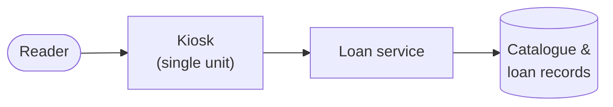
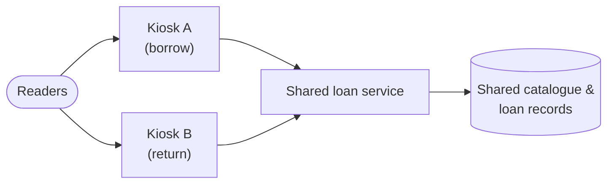
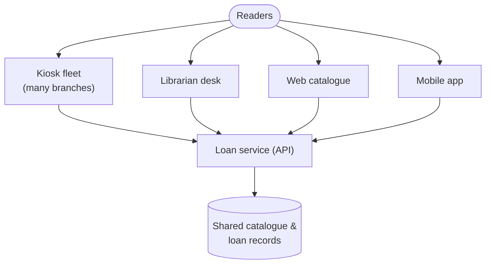

# SSE Task 10 — Mono → Bi → Poly

**Subject:** Soft Engineering · **Course:** 2026 HR S5 Soft Engineering

## Task

Select the system for analysis. Transform the system to the bi-system and define the
benefits of the bi-system. Transform the system to the poly-system and define the benefits
of the poly-system.

---

## The system (mono-system)

I keep the **self-service book-loan kiosk** from Tasks 1–3 (city public library) so the SSE
series stays consistent. In its mono form it is a **standalone kiosk at one branch**: a
single terminal with its own card/RFID reader, its own kiosk app, and its own connection to
the loan service. One device, one place, one entry channel — one system delivering the loan
function to whoever walks up to it.

**Limits of the mono-system:** throughput is capped by one terminal's screen and reader; a
queue forms at peak hours; if the kiosk is down the whole self-service channel is down;
the service exists only during branch opening hours and only at that one location.

---

## 1. Bi-system

**Transformation:** instead of one kiosk I make it a **pair** — the same loan function served
by **two cooperating terminals** that share one catalogue/loan backend, one of them placed at
the branch entrance and one at the returns side (or a second branch). They are not
independent copies: they work against the **same shared loan state**, so a book borrowed at
one terminal is immediately shown as on-loan at the other.

**Benefits of the bi-system**

| Benefit | Why it appears |
|---|---|
| **Higher throughput** | Borrow and return traffic split across two terminals, so the peak-hour queue roughly halves. |
| **Specialisation** | One terminal can be tuned for borrowing, the other for returns — clearer prompts, fewer errors. |
| **Partial fault tolerance** | If one terminal fails, the other still serves readers; only capacity drops, the channel stays up. |
| **Consistent records** | Both terminals read/write one shared catalogue, so no double-booking and no split brain. |
| **Better use of space** | One device per side of the branch matches the actual flow of people (enter = borrow, leave = return). |

The bi-system is still **one service with one shared state**; it just has two entry points.

---

## 2. Poly-system

**Transformation:** I open the same loan function to **many heterogeneous channels running at
once** — the kiosk fleet plus the **librarian desk**, the **web catalogue**, and the **mobile
app** all serving the same catalogue and loan backend. They are different kinds of system
(terminal, human-operated station, browser, phone), not identical copies, and readers can
start on one and finish on another.

**Benefits of the poly-system**

| Benefit | Why it appears |
|---|---|
| **Channel choice** | A reader picks whatever is at hand — kiosk, desk, browser, phone — without extra effort. |
| **Anywhere, anytime service** | Web and mobile have no opening hours and no single building, so the loan function is available 24/7 from home. |
| **Higher total capacity & resilience** | Load is spread across many channels; losing one (a kiosk, a branch, the app) barely affects the whole. |
| **Handles different needs** | Complex cases (overdue disputes, special items) go to the staffed desk; simple self-service goes to the kiosk/app. |
| **Scales by adding units** | More branches = more kiosks onto the same API, no rework of the core loan logic. |
| **One truth, many views** | All channels share one backend, so every reader sees the same availability and due dates. |

---

## Conclusion

The same kiosk system grows in steps: **mono** = one terminal (simple, but one point of
capacity and failure); **bi** = two cooperating terminals on one shared state (more
throughput, first fault tolerance, still one channel); **poly** = many heterogeneous
channels on one backend (ubiquity, resilience, and fit to different reader needs). Each step
adds entry points and users while keeping the **loan logic and shared state** in one place —
which is what makes the growth safe rather than a set of disconnected systems.
