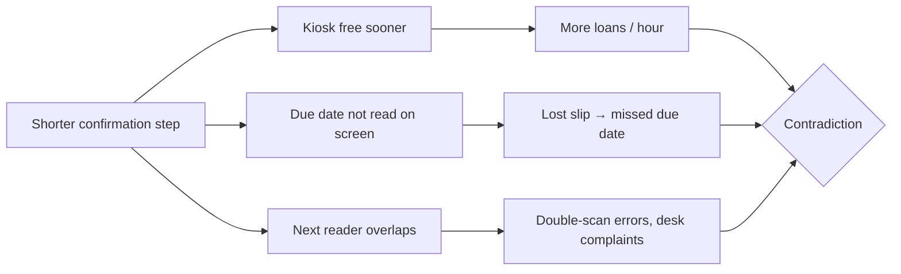

# SSE Task 11 — Contradiction

**Subject:** Soft Engineering · **Course:** 2026 HR S5 Soft Engineering

## Task

- Select a software system and specify the goal of improvement.
- Identify the element that will be changed.
- Define the negative effect of this change.
- Formulate a contradiction: *"If we will [change], then we [desired effect], but this leads to [undesired effect]."*

---

## 1. System and goal

I use the **self-service book-loan kiosk** from Tasks 1–10 (city public library) — the kiosk
app plus the loan service behind it. That keeps the SSE series consistent, and it has a
contradiction worth analysing.

**Goal of improvement:** raise the **number of loans the branch can complete per hour** at
peak times (after work and on Saturday morning, when the queue at the single kiosk is
longest).

## 2. Element to change

The **confirmation step of the borrow flow** — microstage M6 from Task 6, where the kiosk
prints the due-date slip and keeps the loan summary on screen for the reader to read.

**Change:** turn the full confirmation screen into a short summary that disappears after a
few seconds (the slip is printed anyway), so the kiosk goes back to the welcome screen
immediately and the next reader can start.

## 3. Negative effect

- The reader no longer sees the **due date in full** at the moment of the loan — it is only
  on the paper slip.
- The following reader starts scanning while the previous one is still collecting their
  book and slip, so **two people occupy one terminal** and the next transaction starts
  overlapping the previous one, which produces errors ("book already being borrowed").
- Readers who skipped the slip (common) discover the due date only from the reminder email —
  and blame the library.

So the change trades time for certainty: more transactions per hour, but the **confirmation
signal gets weaker**, and weak confirmation is exactly where self-service errors come from.

## 4. The contradiction

> **If we will shorten the confirmation step to a few seconds so the kiosk returns to the
> welcome screen sooner, then we will increase the number of loans completed per hour, but
> this leads to readers not seeing their due date and to overlapping transactions at a single
> terminal (more slips lost, more due-date errors, more reader support requests).**

Compressed: *faster hand-over per reader, but less certainty per reader.*

Diagram of the cause→effect chain:

## 5. Is it a real contradiction?

Yes — both parameters are driven by the **same element**. The confirmation step is the only
moment where the reader is guaranteed to be looking at the screen, so making it shorter
improves throughput and degrades certainty. There is no length that is both "short enough to
free the terminal" and "long enough to be read".

## 6. How I would resolve it (separation)

A contradiction is useful when it points at a separation. Here the opposite demands can be
split by **condition** and by **space**:

| Separation | Move |
|---|---|
| **In space** | The confirmation moves off the shared terminal: the due date is sent to the reader's phone (SMS/app) and printed on the slip, while the *screen* frees up immediately. The terminal is no longer the only place the date lives. |
| **By condition** | Fast confirmation (3 s) for a normal loan, full confirmation (until the reader taps "done") only when something is unusual — a fine, a near-limit warning, or a first loan for that reader. |
| **In time** | Lock the next transaction until the book leaves the RFID pad, so the terminal is freed by the *physical* end of the transaction, not by a timer. |

The chosen resolution is the **first two together**: the reader keeps certainty (phone + slip,
plus the slow path when it matters) and the kiosk regains throughput, because in the routine
case it is idle for 3 seconds, not 20.

---

## Conclusion

The kiosk's improvement target — loans per hour — collides with the confirmation step that
makes each loan trustworthy: shortening it speeds the queue but loses the due date and lets
transactions overlap. The contradiction is genuine because one element controls both
parameters. It is resolved not by picking a batch size for time, but by moving the
confirmation off the shared screen — the reader still gets certainty, the terminal gets its
time back.
