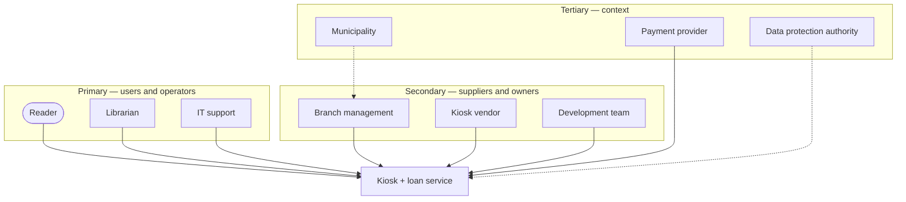

# SSE Task 12 — Stakeholders

**Subject:** Soft Engineering · **Course:** 2026 HR S5 Soft Engineering

## Task

For the chosen system, identify its stakeholders, group them by how close they are to the
system, and describe what each of them wants from it. Then point out where their interests
collide and how those collisions are handled.

---

## The system

I keep the **self-service book-loan kiosk** from Tasks 1–11 (city public library): the
terminal at the branch entrance, the kiosk app, the loan service and the shared catalogue/loan
database behind it.

## 1. Who the stakeholders are

| Stakeholder | Relation | What they want from the system |
|---|---|---|
| **Reader** | primary, external | borrow and return in under a minute, a clear due date, no queue, no fine caused by the machine, minimal data about their reading |
| **Librarian / desk staff** | primary, internal | routine loans off their desk, correct loan records, exceptions (fines, limits, damaged copies) still coming to a human |
| **Library IT support** | primary, internal | uptime, remote diagnostics, simple updates, no unpatched device on the branch LAN |
| **Branch management** | secondary, internal | shorter queues at peak hours, measurable cost per loan, fewer complaints, statistics for the annual report |
| **Kiosk vendor / integrator** | secondary, external | hardware and service contract renewed, spare parts sold, low warranty claims |
| **Software development team** | secondary, external | stable API, requirements that do not change every month, a maintainable codebase |
| **Municipality (funding body)** | tertiary, external | service within budget, equal access for all residents, public procurement rules respected |
| **Payment provider / bank** | tertiary, external | card payments for fines processed securely, its fee paid, PCI DSS rules followed |
| **Data protection authority** | tertiary, external | loan history kept only as long as necessary, readers informed, data minimised (GDPR) |

## 2. Stakeholder map

The closer the ring, the more directly the stakeholder touches the system and the more often
their requirements change it. Tertiary stakeholders rarely talk to the system, but they set
the rules it must obey.

## 3. Where interests collide

| Tension | Sides | How it is handled |
|---|---|---|
| **Speed vs accountability** | Reader wants a 20-second loan; management and the data-protection side need a traceable record of who holds which copy | Keep only what the loan needs (card id, copy id, dates), show the due date on screen and on the slip, purge history after the retention period |
| **Self-service vs exceptions** | Reader wants no staff contact; librarian does not want the kiosk pushing messy cases back to the desk | The fast path stays automatic, the slow path (fine, limit reached, first loan for this reader) hands over to the desk — the same split I used in Task 11 |
| **Stability vs new features** | IT wants an untouched, working terminal; management wants new functions (renewals, reservations) | Fixed update windows, remote rollout, a test kiosk at one branch before the rest |
| **Cost vs reliability** | Municipality pays; vendor and IT want proper maintenance | Service contract with an uptime SLA — the cost of downtime is written into the contract instead of discovered at the desk |

## 4. Who decides what

The **reader** is the reason the system exists, but has the least formal power: a complaint
reaches the desk, not the backlog. **Branch management** and the **municipality** control the
budget and therefore the priorities. **Librarians and IT** have the strongest practical
influence, because they live with the consequences of every design decision. In a conflict I
would let the reader's needs set the goal, and let operations and budget set the constraints
— that is the order in which the requirements above are actually negotiable.

---

## Conclusion

The kiosk has nine stakeholders in three rings: readers, librarians and IT who use it daily;
management, the vendor and the development team who own and supply it; and the municipality,
the payment provider and the regulator who set its rules. Their interests overlap on
throughput and accurate records, and collide on speed vs traceability, automation vs
exceptions, and cost vs reliability — which is exactly where the kiosk's requirements have to
be negotiated rather than assumed.
