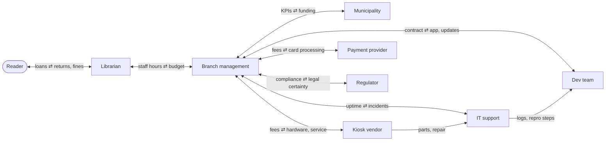

# SSE Task 14 — Stakeholder Value Network

**Subject:** Soft Engineering · **Course:** 2026 HR S5 Soft Engineering

## Task

Build a stakeholder value network for the chosen system: the stakeholders are the nodes, the
value they exchange are the links. Then read the network — which links are reciprocal, where
the hub is, and where value does not reach.

---

## The system

The **self-service book-loan kiosk** from Tasks 1–12 (city public library). Task 12 already
named the nine stakeholders and what each of them wants; here I look at what actually moves
between them.

## 1. The value exchanges

| # | Link | Value going forward | Value coming back |
|---|---|---|---|
| V1 | Reader → Librarian | returns, fine payments, complaints, usage | loans, due dates, help with exceptions |
| V2 | Librarian → Branch management | staff hours, exception handling, operational knowledge | budget for staffing, policy decisions |
| V3 | Branch management → Municipality | service KPIs, spending report, complaint statistics | funding, mandate, procurement rules |
| V4 | Branch management → Kiosk vendor | service contract money | terminals, spare parts, on-site repair |
| V5 | Branch management → Dev team | maintenance contract, requirements, test access | kiosk app, updates, second-line support |
| V6 | Branch management → Payment provider | transaction fees | card processing for fines, PCI-compliant settlement |
| V7 | Branch management → Regulator | records of processing, retention policy, breach notices | legal certainty, guidance |
| V8 | IT support → Branch management | uptime, monitoring, incident reports | remote access, maintenance window |
| V9 | Vendor → IT support | parts, repair visits | access to the terminal, fault descriptions |
| V10 | IT support → Dev team | logs, reproduction steps | fixes, patches |

Most links carry **two kinds of value at once**: a service one way and money, data or
feedback the other. That is what makes the network a network and not a list of suppliers.

## 2. The network

## 3. Reading the network

**The main value cycle.** Reader → Librarian → Management → Municipality → back to the
Reader as a working service. It closes only if the KPIs are trusted: the municipality does
not see loans, it sees the report about loans. Everything the reader gets ultimately depends
on that reporting link being honest.

**The money loop.** Funding goes Municipality → Management, and from Management out to the
vendor, the dev team and the payment provider. Money leaves the library; service comes back.
If one of those three links is cut, the reader notices within a week — but the person who
feels it first is the librarian at the desk.

**The hub.** Branch management has seven of the ten links. It is the only node that talks to
the municipality, the vendor, the dev team, the payment provider and the regulator, so it
carries the whole external side of the network. That is efficient, and also fragile: a
management vacancy or a slow procurement stops every one of those flows at once.

**Asymmetries.**
- The reader supplies the data and the fines but has **no direct link to the municipality** —
  complaints travel Reader → Librarian → Management and lose force at each hop.
- The dev team never meets the reader; requirements reach it through management, so the
  "telephone game" is built into the network.
- IT support and the vendor exchange parts and fault reports informally, without a contract
  link, although both depend on each other for uptime.

## 4. What I would add

| Gap | Link to add |
|---|---|
| Reader's voice is indirect | A light feedback link Reader → Management (kiosk rating, annual survey) so complaints reach the budget holder without three hops |
| Dev team is insulated from use | Quarterly session where the dev team watches real kiosk usage, or a shared incident digest |
| Vendor ↔ IT is informal | Incident tickets with the vendor under the existing service contract, so repair time becomes visible |
| KPIs are self-reported | Municipality samples kiosk logs directly instead of relying only on the branch report |

---

## Conclusion

The kiosk's stakeholder value network is a chain, not a star: readers, librarians, management
and the municipality form the value cycle that keeps the service funded and staffed, while
the vendor, the dev team, the payment provider and the regulator hang off management as
suppliers of capability and rules. The links are mostly reciprocal, which is healthy; the
weak points are the reader's missing direct line to the funding body and the dev team's
distance from actual use. Those are the two links I would add first.
