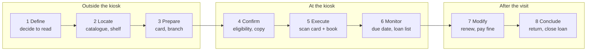

# SSE Task 16 — User Jobs

**Subject:** Soft Engineering · **Course:** 2026 HR S5 Soft Engineering

## Task

Identify the jobs users hire the chosen system to do, state them as job statements, and break
the main job into the steps the user actually goes through.

---

## The system

The **self-service book-loan kiosk** from Tasks 1–15 (city public library). Task 6 already
described what the product does in three use cases; here I look at the same thing from the
user's side: what they are trying to get done, with or without the kiosk.

## 1. Who has the job

| Executor | Job in one line | Why the kiosk matters to them |
|---|---|---|
| **Reader** | get library material and give it back on their own schedule | it removes the desk and the opening-hours queue from the routine |
| **Librarian** | keep the loan record true without handling every loan | the kiosk takes the routine, leaves the exceptions |
| **IT support** | keep the terminal available | a dead kiosk becomes a queue at the desk |

The reader is the main executor: the other two have jobs *because* the reader's job is
delegated to a machine.

## 2. Job statements

A job statement names what the user wants, not what the product is. If the word "kiosk" fits
into the sentence, it is a solution, not a job.

> **Main job:** *Borrow and return library material when it suits me, without depending on
> staff.*

| # | Job statement | Type |
|---|---|---|
| U1 | Get a book I want into my hands today | functional, core |
| U2 | Know what I am holding and when it is due | functional, supporting |
| U3 | Close a loan and be sure it is really closed | functional |
| U4 | Not be blamed for a mistake the machine made | emotional |
| U5 | Not hold up the people behind me | social |
| U6 | Keep what I read to myself | emotional / social |
| U7 | Finish the day with records that match the shelf *(librarian)* | functional |
| U8 | Know a terminal is broken before the readers do *(IT)* | functional |

U4–U6 are the ones a purely functional description loses. They do not add features; they set
the tone of the error messages, the length of the session and how much the system stores.

## 3. Job map of the main job

The main job does not start at the kiosk. Broken into the eight universal steps:

| Step | What the reader does | Who supports it today |
|---|---|---|
| 1 Define | decides they need a book | themselves |
| 2 Locate | searches the catalogue, finds the shelf | catalogue, signage |
| 3 Prepare | takes the card, comes to the branch, queues | branch, opening hours |
| 4 Confirm | checks the copy and their own eligibility | kiosk (M1–M4 in Task 6) |
| 5 Execute | scans the card and the book | kiosk (M5) |
| 6 Monitor | reads the due date, checks the loan list | kiosk (M6), later reminders |
| 7 Modify | renews, returns early, pays a fine | desk or web account |
| 8 Conclude | returns the copy and closes the loan | kiosk or drop point |

## 4. What the map shows

The kiosk covers steps 4–6 well and step 8 partly. Steps 1–3 and 7 happen outside it, and
that is where the reader's job is actually lost: a book that is "in the catalogue" but not on
the shelf, a card left at home, a renewal that needs a desk visit. No amount of screen polish
fixes those — they need the catalogue, the shelf and the account to agree with the kiosk.

The map also explains the weight of the emotional jobs. U4 only appears when step 4 or 8 goes
wrong, and U5 only exists because step 5 happens in public, with a queue behind. That is why
Task 15 put four of its eight stories in error and recovery situations: those situations are
where the job is either finished or abandoned.

---

## Conclusion

The reader hires the kiosk for one job — borrow and return on their own schedule — which
breaks into eight steps, only three of which are really the kiosk's. The other five belong to
the catalogue, the branch and the account, and that is the part of the job the system has to
connect to rather than replace.
