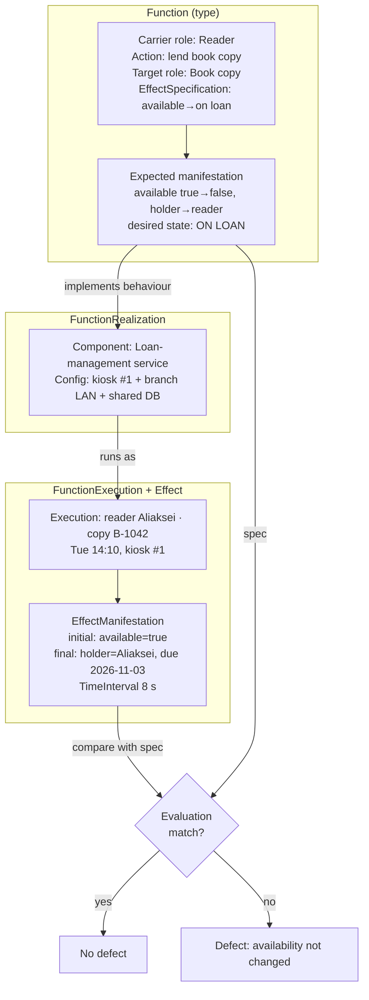

# SSE Task 2 — Build a Function Graph

**Subject:** Soft Engineering · **Course:** 2026 HR S5 Soft Engineering

## Task

Select one system and one meaningful function. Build a small graph that separates the
behavior type from the actual execution and effect. Define the **Function**
(carrier role · action · target role · EffectSpecification); specify the **expected
manifestation** (parameter + change or preservation + target/desired state); define one
**FunctionRealization** (implementing SystemComponent / configuration); describe one
**FunctionExecution** (actual carrier · target · context/time); record
**FunctionEffect + EffectManifestation** (initial/final state or desired state +
TimeInterval); evaluate the result — compare with the EffectSpecification and identify a
defect if present.

---

## The system and function

I keep using the **self-service book-loan kiosk** from Task 1. The meaningful function I
pick is **"lend a book copy to a reader"** — the single behaviour that the whole kiosk
exists to deliver.

### 1. Function (behaviour type, not execution)

| Field | Value |
|---|---|
| **Carrier role** | Reader (borrower) — the role that triggers the borrow |
| **Action** | lend a book copy under the loan rules |
| **Target role** | Book copy (the loanable item) |
| **EffectSpecification** | the copy changes from *available on shelf* to *on loan to this reader*, with a due date set |

This is the **required behaviour**: it says what the function must achieve, independent of
any machine that performs it.

### 2. Expected manifestation

| Aspect | Value |
|---|---|
| **Parameter** | copy availability + holder |
| **Change or preservation** | **change**: `available = true → false`, `holder = none → reader` |
| **Target / desired state** | copy state = *ON LOAN*, holder = requesting reader, due date = today + 21 days |

### 3. FunctionRealization (what implements it)

The realization is the concrete design that can satisfy the behaviour:

- **SystemComponent:** the *Loan-management service* (with the kiosk app as its front end).
- **Configuration:** one kiosk at the branch entrance, card reader + RFID pad, talking over
  the branch LAN to the catalogue/loan DB shared with the librarian desk.

Same behaviour could be realized differently (librarian desk, mobile app), so the
realization is a design choice, not the function itself.

### 4. FunctionExecution (actual run)

| Field | Value |
|---|---|
| **Actual carrier** | reader Aliaksei, branch kiosk #1 |
| **Target** | copy of *"Clean Code"*, tag B-1042 |
| **Context / time** | Tuesday 14:10, branch opening hours, LAN online |

**Steps:** reader taps card → scans the book → service checks availability → loan is
created → due date printed and shown.

### 5. FunctionEffect + EffectManifestation (what actually happened)

| Aspect | Value |
|---|---|
| **Initial state** | B-1042 available = true, holder = none |
| **Final state** | B-1042 available = false, holder = Aliaksei, due 2026-11-03 |
| **TimeInterval** | 14:10:03 → 14:10:11 (8 s) |

### 6. Evaluation against the EffectSpecification

| Criterion (spec) | Actual | Verdict |
|---|---|---|
| availability changes true → false | yes | met |
| holder becomes the reader | yes | met |
| due date = today + 21 days | 2026-11-03 (21 days) | met |
| completes in a reasonable time | 8 s | met |

**Result:** the execution matches the EffectSpecification — no defect in this run.

**Where a defect would show:** if the service created the loan but the DB write failed
after the due-date print, the copy would stay `available = true` while the reader walks
away with it. That is a **real defect** (spec says availability must change, actual state
preserved) and it is exactly what the graph is meant to catch — the behaviour type and the
executed effect diverge.

---

## Function graph

The graph separates the three layers: **behaviour** (what must happen) → **realization**
(what implements it) → **execution + effect** (what actually happened), then feeds the
effect back into the evaluation against the spec.

---

## Conclusion

Separating the **function (behaviour type)** from its **realization** and from a single
**execution** makes the graph re-usable: the same "lend a book copy" function can be
realized by a kiosk, a desk, or a mobile app, and every execution can be judged against the
one shared EffectSpecification. In this run the effect matched the spec; the graph also
shows precisely where a defect would appear if the physical state and the recorded state
ever disagree.
