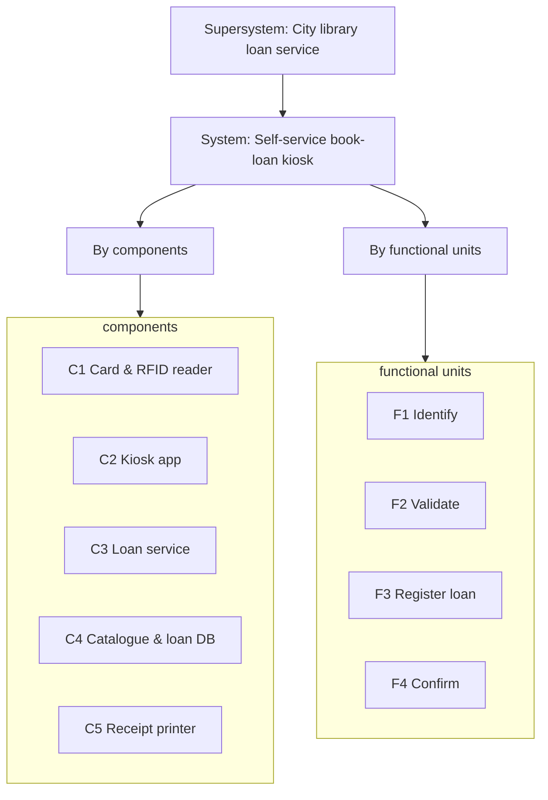

# SSE Task 3 — Define System Hierarchy

**Subject:** Soft Engineering · **Course:** 2026 HR S5 Soft Engineering

## Task

Choose a system for analysis. Define the supersystem that the initial system is a part of.
Break the system down into its parts — by components, or by functional units.

---

## The system

I keep the **self-service book-loan kiosk** from Tasks 1–2 (city public library) so the
whole SSE series stays consistent. Here I look at it as one level inside a hierarchy:
what it is part of (above), and what it is made of (below).

### 1. Supersystem

The kiosk on its own does nothing useful — it needs a library around it.

**Supersystem:** the **city public library loan service** — the branch with its physical
collection, its readers, its backend, and its staff.

The kiosk is one *entry channel* into that service, alongside the librarian desk and the
web catalogue. The supersystem sets the rules the kiosk must obey: loan period (21 days),
borrowing limits, member eligibility, opening hours. The kiosk only executes them.

| Level | System | Role in the level above |
|---|---|---|
| Supersystem | City public library loan service | provides the rules, collection and members |
| **System** | **Self-service book-loan kiosk** | one entry channel to borrow/return a book |
| Subsystem | Loan-management service | applies the loan rules for the kiosk |

### 2. Decomposition

The task allows either a component breakdown or a functional one. I do both, since they
answer different questions — what the kiosk is *made of*, and what it *does*.

**By components (structure):**

| # | Part | Responsibility |
|---|---|---|
| C1 | Card & RFID reader | identifies the reader and the book copy |
| C2 | Kiosk application | UI, prompts, error messages |
| C3 | Loan-management service | checks availability, eligibility, due date |
| C4 | Catalogue & loan-records DB | stores copy location and who holds what |
| C5 | Receipt printer | prints the due-date slip |

**By functional units (behaviour):**

| # | Functional unit | What it delivers |
|---|---|---|
| F1 | Identify | resolve reader + copy from card and RFID tag |
| F2 | Validate | check membership, availability, loan limits |
| F3 | Register loan | create the loan record and set the due date |
| F4 | Confirm | print the slip and update the on-screen state |

The two views line up: C1+C2 serve F1, C3 serves F2 and F3, C4 stores the result of F3,
C5 delivers F4.

---

## Conclusion

Placing the kiosk in a hierarchy makes its boundaries clear: above it sits the **library loan
service** that defines the rules, below it sit **five components** (structure) and **four
functional units** (behaviour). Keeping both decomposition views side by side shows how the
structure delivers the behaviour.
