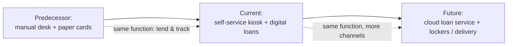

# SSE Task 4 — Define System Evolution

**Subject:** Soft Engineering · **Course:** 2026 HR S5 Soft Engineering

## Task

Choose a system. Define the system that preceded the system under analysis. Determine the
problems solved in the system under analysis. Determine the problems not solved in the
system under analysis. Define the image of the future system.

---

## The system

The same **self-service book-loan kiosk** from Tasks 1–3 (city public library).

### 1. The preceding system

Before the kiosk, borrowing and returning a book was handled entirely at the
**librarian desk**: the reader showed a paper membership card, the librarian found the card
in a file box, checked the book's stamped due-date slip, wrote the return date, and filed a
paper loan card by hand.

So the predecessor is: **manual loan processing at the librarian desk** — the same
function (lend a copy, track who holds it), done by a person with paper records.

The kiosk did not change *what* the system does; it changed *who* performs the routine and
*where* the record lives — a computer instead of a card file.

### 2. Problems solved in the kiosk system

| Problem in the predecessor | How the kiosk solves it |
|---|---|
| Reader has to wait in the desk queue, often behind someone returning 10 books | Self-service borrow/return in under a minute |
| Desk works only while a branch is staffed | Kiosk stays available all opening hours (and beyond at an outdoor unit) |
| Paper loan card can be misfiled, so a "lost" book looks borrowed | Single digital loan record, updated at the moment of the transaction |
| Accumulating overdue fines and notifications have to be worked out by hand | Due date is computed and set automatically; reminders come from the same record |
| Book availability is only known by walking to the shelf | Catalogue state reflects loan status immediately |

### 3. Problems not solved in the kiosk system

- **Only one branch, one floor.** The book still has to be physically in that building, on
  a shelf near the kiosk — no borrowing from home or from another branch.
- **Hold/reservation is weak.** The kiosk handles borrow and return, not "reserve this copy
  for Thursday" — that still goes through a librarian.
- **Physical dependence.** Cards lose, RFID tags fail, a reader with a broken card cannot
  borrow at all; there is no fallback except the desk.
- **No recommendation or discovery.** The reader must already know the title; the kiosk does
  not help them find it.
- **Human judgement is gone.** A damaged copy, a doubtful membership, a special case — the
  kiosk refuses and sends you to a person anyway.
- **Still requires the branch staff as a fallback**, so routine work was reduced but not
  removed.

### 4. Image of the future system

The next step is the **library loan service without a fixed point of presence**: the loan
record moves to a cloud service, and borrowing becomes a request on the reader's own
device.

- The reader searches the union catalogue of all branches, reserves a copy, and gets it
  either at a smart locker in their district or by courier.
- Identification is by the reader's phone (digital membership), so no plastic card is needed.
- Returning works the same way: drop the book into any locker, the same record closes.
- The kiosk itself becomes one channel among many — a device the service *uses*, not the
  service *is*.

The three stages keep one purpose and one process object (the **Loan**) — what evolves is
the carrier: the librarian's hand, then the kiosk, then the network service.

---

## Conclusion

The kiosk system solved the desk's throughput, availability and record-keeping problems, but
it is still tied to one building, one card and one device. Its natural evolution is to
detach the loan records from the physical kiosk and let the service reach the reader wherever
they are.
