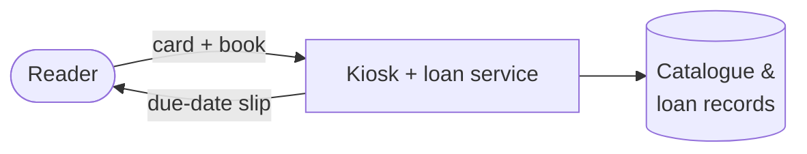
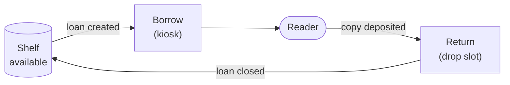

# SSE Task 5 — Define Anti-System

**Subject:** Soft Engineering · **Course:** 2026 HR S5 Soft Engineering

## Task

Define the system.
Define function and action that the system is performing.
Define the opposite action.
Define the useful system that performs the opposite action.
Try to merge the initial system and anti-system.

---

## 1. The system

The same **self-service book-loan kiosk** from Tasks 1–4 (city public library): a terminal
that lets a registered reader borrow and return a physical copy without a librarian.

## 2. Function and action

| Aspect | Value |
|---|---|
| **Function** | lend a copy out of the collection — move a book from the library to the reader |
| **Action** | the copy leaves the shelf: `available = true → false`, holder becomes the reader, due date is set |
| **Direction** | book goes **out**, record moves to `ACTIVE`, the collection in the building gets smaller |

## 3. Opposite action

**Take a copy in** — the book moves from the reader back into the collection:

| Aspect | Value |
|---|---|
| **Opposite action** | `available = false → true`, holder = reader → none, the copy re-enters the shelf |
| **Direction** | book goes **in**, record moves to `CLOSED`, the collection in the building gets bigger |

This is not "do nothing" or "refuse a loan" — a real anti-action changes the state in the
mirror direction.

## 4. The useful system that performs the opposite action

The anti-system is **the returns side of the library service**: a separate **book-drop /
returns station** — a slot in the branch wall where readers deposit copies, plus the returns
service that matches a deposited copy to its loan and puts it back into available stock.

It has real value on its own:

- **Returns are what feed the collection.** Borrowing only redistributes copies, but returns
  make a popular title lendable again. A library that lends and never gets books back
  drains itself.
- **It runs at different times and with different effort.** A drop slot works outside staffed
  hours, takes one motion, no card and no choice — the reader's job is different.
- **It is a separate system, not a mode.** It owns the in-flow and its own failure cases
  (deposited copy with no matching loan, copy returned in the wrong branch).

## 5. Merging the system and the anti-system

Merged naively, the two systems give a one-way flow through one box, and the book only
changes state twice with no hinge between them. The useful merge is **the circulation loop**:
one loan record, one copy state machine, two entry points sitting at opposite ends of it.

What the merge buys:

| | Before (separate) | Merged (circulation loop) |
|---|---|---|
| **Loan record** | created at the kiosk, closed somewhere on the returns side | one record, both ends update it |
| **Copy state** | two partial views of the same book | one state machine, `available ⇄ on loan` |
| **Reader experience** | borrow and return feel like two unrelated services | both ends self-service, same rules |
| **Value** | lending is visible, returns are a chore | every return immediately creates lendable stock |

The merge is only safe because both ends share the **same loan record** — a copy returned
through the slot is the same object the kiosk lent, and its state is unchanged by which door
it came through.

---

## Conclusion

The kiosk's anti-system is not an enemy but its complement: the returns side moves the copy
in exactly the direction the kiosk moves it out. Merged through a shared loan record, they
stop being two services and become one **circulation loop** — which is what a library actually
needs, since a lending system without returns only empties the shelf.
