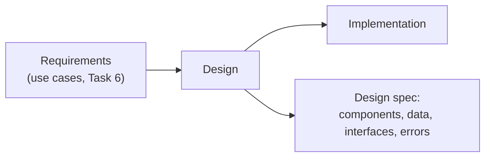

# SSE Task 7 — Analyse SDLC Stage

**Subject:** Soft Engineering · **Course:** 2026 HR S5 Soft Engineering

## Task

Select the SDLC stage for analysis.
Define 3–5 microstages for the selected stage.
For each microstage define the interaction scenario (including stakeholder with its role).

---

## 1. The SDLC stage

I analyse the **design (development) stage** of the same **self-service book-loan kiosk**
product from Tasks 1–6 — the moment after the requirements are agreed and before anyone
writes the kiosk application.

I pick it because it is the stage where the earlier SSE work actually gets used: the system
model, function graph, hierarchy and use cases from Tasks 1–6 are the *input* of this stage,
and the design decisions made here fix the structure of everything that follows.

**Stage goal:** turn the agreed requirements into a design that the implementation team can
build without guessing — structure, data, interfaces and error behaviour are decided here.

Input: the requirement set and the use-case chain from Task 6 (identify → validate → act →
confirm).
Output: a design specification — component split, data model, interface contracts, and the
rules for failure handling.

## 2. Microstages of the design stage

| # | Microstage | What is decided |
|---|---|---|
| **D1** | Architectural design | which components exist and how they talk (kiosk app ↔ loan service ↔ catalogue DB) |
| **D2** | Data & state design | the Loan object, the copy state, and the rules that keep them consistent |
| **D3** | Interaction design | the screen flow and the messages the reader sees at each step of a use case |
| **D4** | Interface design | the contracts between the kiosk and the services — including card and RFID input |
| **D5** | Design review | check the design against the requirements and fix or accept the gaps |

These five run in the order shown but overlap in practice: interface design constantly sends
D1 and D2 back for correction.

## 3. Interaction scenarios

Each scenario names the stakeholder, their role in that microstage, and what goes between
them.

### D1 — Architectural design

**Stakeholders & roles:** *system analyst* (explains what the requirements imply),
*solution architect* (owns the decision), *software engineer* (sanity-checks feasibility).

**Scenario:** the analyst walks the architect through the Task 6 use cases; the architect
sketches the component split (kiosk app, loan service, catalogue/loan DB) and the architect's
options are contested by the engineer on the cost of each. It ends with one chosen structure
and a short list of rejected alternatives.

### D2 — Data & state design

**Stakeholders & roles:** *data designer / architect*, *librarian* (domain expert on loan
rules), *software engineer* (will implement it).

**Scenario:** the designer drafts the Loan record and the copy state; the librarian checks the
rules against real policy — 21-day period, borrowing limit, what counts as damage, when a fine
starts. Where the design contradicts the policy, the librarian rejects and the designer
revises. Output: the data model plus the transition rules.

### D3 — Interaction design

**Stakeholders & roles:** *UX/UI designer* (owner), *reader* (end user), *librarian*
(representing the library's tone and the exception cases).

**Scenario:** the designer produces the screen flow for borrow, return and check-loans; the
reader is asked to walk through it on a paper prototype — where a prompt is unclear the
reader is the one who says so. The librarian supplies the wording for error states ("card
not recognised — go to the desk"). Prototype is accepted when the reader can finish each job
without help.

### D4 — Interface design

**Stakeholders & roles:** *software engineer / API designer*, *solution architect* (approves
the contract), *hardware technician* (the card reader and RFID pad).

**Scenario:** the engineer writes the call contracts between the kiosk app and the loan
service, and the reader-side contract with the card/RFID hardware; the technician checks the
timings and failure modes of the devices; the architect approves the contract so the
implementation teams can work in parallel against it.

### D5 — Design review

**Stakeholders & roles:** *solution architect* (chair), *system analyst* (checks against the
requirements), *software engineer* and *UX designer* (authors), *library project owner*
(signs off).

**Scenario:** the analyst walks the design against each Task 6 use case and each microstage
and asks "is this covered?"; the engineer and designer answer or commit to a fix; the architect
decides accept / revise / escalate; the library owner gives the final sign-off. The result is
an approved design spec with a short list of open risks carried into implementation.

## 4. Summary

| Microstage | Main stakeholder(s) | Output |
|---|---|---|
| D1 Architectural design | architect, analyst, engineer | component structure |
| D2 Data & state design | data designer, librarian | Loan model + state rules |
| D3 Interaction design | UX designer, reader, librarian | screen flow, wording |
| D4 Interface design | engineer, architect, hardware technician | call contracts |
| D5 Design review | architect, analyst, project owner | approved spec, open risks |

---

## Conclusion

The design stage is not one step but five small decisions in a chain — architecture, data,
interaction, interfaces, review — and each of them needs its own counterparty: the librarian
in data design, the reader in interaction design, the technician in interface design. Naming
the stakeholder and their role per microstage is what makes the stage reviewable: a decision
without an owner is exactly the kind of decision that later becomes a defect in implementation.
