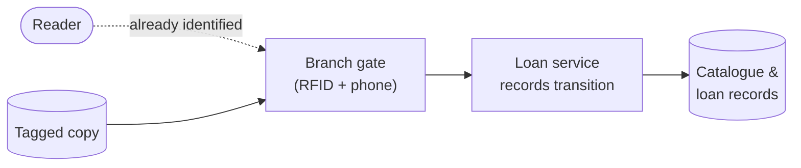

# SSE Task 9 — Ideal System

**Subject:** Soft Engineering · **Course:** 2026 HR S5 Soft Engineering

## Task

Select the system for analysis.
Define the useful function.
Define the ideal system for the function.

---

## 1. The system

The **self-service book-loan kiosk** from Tasks 1–5 (city public library): a terminal plus the
loan service behind it, letting a reader borrow or return a copy without a librarian.

## 2. The useful function

| Aspect | Value |
|---|---|
| **Function** | make a physical copy available to the reader who has chosen it — and get it back into the collection afterwards |
| **Who performs it** | currently the kiosk (borrow) and the drop slot (return), on top of the loan service |
| **Effect wanted** | one copy changes hands, the loan record stays true |
| **What we actually pay for it** | hardware, money, screen interaction, a queue at peak hours, a card that must be present |

In TRIZ terms this is the function we want to deliver **without the system that delivers it** —
the IFR question: *what has to change so the useful effect happens with the fewest resources
and the least harm?*

## 3. The ideal system

An ideal system is one where the useful function is performed **by itself** — the carrier
disappears, but the effect stays. For this function I formulate it in three steps.

**IFR statement:** the copy itself registers its own loan and return; no terminal, no card,
no reader interaction is required for the routine case.

How it works, mechanically: the RFID tag on each copy is the carrier. A reader passing the
branch exit gate (borrow) or entering the returns zone (return) is already identified by
their phone, and the gate → loan service → catalogue chain records the transition directly.
The kiosk screen remains only for exceptions.

### Comparison

| Aspect | Current kiosk | Ideal system |
|---|---|---|
| **Interaction** | tap card, scan book, read screen | walk in / walk out |
| **Carrier** | dedicated terminal per branch | the copy's own tag + the gate already installed |
| **Time per action** | ~8 s plus queue | ~0 s of extra effort |
| **Capacity** | one terminal, peak-hour queue | every reader at the gate at once |
| **Cost** | kiosk hardware, maintenance, screens | incremental: tags + gate software |
| **Effect** | loan/return recorded | same effect, without a terminal in the way |

### Why it is ideal, and where it stops

The ideal system is an **idealization, not a design**: it pushes the cost into the tag and the
gate, which already exist, and removes the dedicated device. The limit is the useful effect
that cannot be moved for free:

- the **rare cases** (unreadable tag, disputed loan, damaged copy) still need a person or a
  screen — they are exactly where the ideal breaks down;
- the ideal system works only while the **reader's phone is with them and authorised** — an
  ideal that quietly reintroduces a dependency we should name.

So the honest formulation is: *ideal for the routine path, exceptional for everything else* —
the ideal system absorbs ~90% of the transactions and leaves the kiosk to the remaining 10%.

---

## Conclusion

The useful function is "a copy changes hands and the record stays true", and the ideal system
delivers it without the kiosk: the copy registers itself at the gate, the reader is already
identified, and the terminal drops to an exception channel. That is the value of the ideal
system here — it is not a fantasy, it tells us where to invest: in tags and gate software
first, in kiosk hardware only for the cases the ideal cannot cover.
