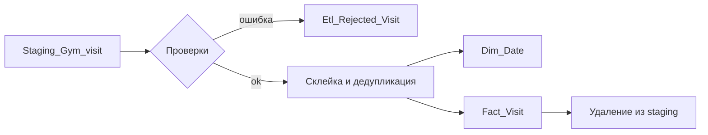

# HomeTask #1 — ETL

Нужно было написать ETL-скрипт, который переносит визиты из `Staging_Gym_visit` в таблицы DWH
(`Dim_Date`, `Fact_Visit`), чистит мусор и умеет отработать второй набор данных из `HT1_part_2.sql`.

Всё решение — один файл `etl.sql`: таблица для отбракованных строк, процедура `run_etl()` и её вызов.

## Как работает `run_etl()`



1. **Dim_Date** — по всем датам из staging вставляю отсутствующие дни (`on conflict do nothing`),
   день/месяц/названия считаю через `to_char`.
2. **Проверки** — строки, которым нельзя доверять, уезжают в `Etl_Rejected_Visit` с причиной
   и удаляются из staging.
3. **Склейка** — Gym_1 пишет визит одной строкой, Gym_2 — двумя (`time_in` в одной, `time_out` в другой).
   Пары ищу внутри одного `gym_code + personal_code + visit_date`, сортируя строки по времени
   (`row_number()`), чтобы `time_out` попал именно к своему `time_in` и строка не использовалась дважды.
4. **Дубликаты** — одинаковые строки (тот же человек, зал, дата, вход и выход) группируются
   в один визит, в `src_ids` собираются все `v_id`, поэтому из staging удаляются все копии.
5. **Расчёт** — `visit_duration` в минутах: `extract(epoch from time_out - time_in) / 60`;
   `day_part` по `time_in`: до 10:00 — Morning, 10:01–17:00 — Day, после 17:01 — Evening.
6. **Загрузка и очистка** — вставка в `Fact_Visit` и удаление обработанных строк из staging.

## Какие строки отбраковываются

| Причина | Пример из данных |
|---|---|
| `time_out` не позже `time_in` | 15:00 → 13:00 (P1, 01.04), 16:00 → 15:00 (P4) |
| имя не соответствует `personal_code` | P3 записан как `L1 F1` |
| имя отсутствует — сверить не с чем | P1, 07:00–08:00 |
| код человека/зала не найден в измерениях | — (на будущее) |
| нет ни входа, ни выхода | — |

Формат имени учитывается: для Gym_1 `Фамилия Имя`, для Gym_2 `Имя Фамилия`, сравнение идёт без учёта регистра.

Незавершённые визиты (есть только вход) — это не ошибка: они остаются в staging до следующего запуска.
Когда приходит полная строка с тем же входом, старая «половинка» удаляется как поглощённая.

## Запуск

```sql
\i HT1_part1.sql   -- схема DWH + первый набор данных
\i etl.sql         -- создаёт ошибки-таблицу и процедуру, сразу вызывает run_etl()
\i HT1_part2.sql   -- второй набор данных
call run_etl();    -- догрузка
```

## Результат

После первого запуска: загружено 4 визита, отбраковано 4 строки, схлопнут 1 дубликат,
2 незавершённых визита остались в staging. После `HT1_part_2.sql` и повторного вызова:
загружено ещё 3 визита, staging пуст, ошибок не добавилось.

| Зал | Кто | Дата | Длительность | Day_part |
|---|---|---|---|---|
| Gym_1 | P1 | 2025-04-03 | 60 | Day |
| Gym_1 | P2 | 2025-04-04 | 110 | Day |
| Gym_2 | P5 | 2025-04-03 | 60 | Morning |
| Gym_2 | P6 | 2025-04-04 | 80 | Evening |
| Gym_1 | P1 | 2025-04-05 | 60 | Day |
| Gym_1 | P3 | 2025-04-04 | 90 | Evening |
| Gym_2 | P5 | 2025-04-04 | 70 | Morning |

Итого 7 визитов в `Fact_Visit` и 4 строки в `Etl_Rejected_Visit`. Повторный запуск процедуры
на пустом staging ничего не дублирует: загружается 0 строк.
